# TDD — Dokumen Reka Bentuk Teknikal
## Sistem IKAWAL — Iringkawal Reman & Data Tahanan JIM Sabah

> **Nota:** Dalam dokumen ini, **TDD = Technical Design Document** (Dokumen Reka Bentuk Teknikal) —
> **bukan** Test-Driven Development. TDD menjawab **"BAGAIMANA"** sistem dibina, manakala PRD
> menjawab **"APA & MENGAPA"**. Dokumen ini disusun mengikut prinsip *Spec-Driven Development*
> (Definisi → Reka Bentuk → Perjanjian → Bina).

---

## 0. Kawalan Dokumen

| Perkara | Maklumat |
|---|---|
| Tajuk | TDD Sistem IKAWAL (Iringkawal Reman JIM Sabah) |
| Versi | 1.0 |
| Tarikh | 27 November 2026 |
| Pemilik Teknikal | Jurutera Sistem / Pembangun IKAWAL |
| Pihak Berkepentingan | Pegawai Penguatkuasa, Penyelia, Ketua Unit (Boss), Pentadbir Sistem |
| Status | Draf untuk semakan |
| Rujukan | `Spec-Driven Development for Immigration Systems.pptx`; `README.md` projek; `app.py`; `dashboard/build_data.py` |
| Repositori | `https://github.com/amirraihan/IKAWAL` (branch kerja: `UC1`) |

### Rekod Semakan
| Versi | Tarikh | Perubahan | Oleh |
|---|---|---|---|
| 1.0 | 27/11/2026 | Versi pertama — seni bina, ERD, sequence, API, keselamatan, kegagalan, trade-off | IKAWAL |

---

## 1. Ringkasan Eksekutif

**IKAWAL** ialah sistem sokongan keputusan untuk pemantauan **kes reman** dan **tahanan warga
asing** di Depot Tahanan Imigresen (BPK), khususnya JIM Sabah. Ia mengumpul data kemasukan harian,
memaparkan KPI & carta analitik, menjana laporan PDF, mencetak **Notis Reman Seksyen 35**, serta
menyediakan pembantu AI tempatan (**Devin**) — semuanya tanpa menghantar data keluar.

Sistem terdiri daripada **empat front-end** atas **satu sumber data**:

1. **Aplikasi Flask + SQLite** (`app.py`, `templates/`) — dashboard pelayan, log masuk berperanan, API JSON, import Excel/CSV, eksport PDF, log audit.
2. **`app.html`** — Iringkawal BPK 2026 (satu fail berdiri sendiri): log masuk 3 peranan, CRUD, Laporan PDF, Devin.
3. **`sistem_tahanan.html`** — Sistem Data Tahanan + Auto Cetak Reman 35 (satu fail berdiri sendiri), dengan Devin.
4. **`dashboard/index.html`** (+ `data.js`) — Dashboard analitik **Reman JIM Sabah** (React + Recharts + Leaflet), dipandu agregat sebenar dan Devin.

---

## 2. Skop

### 2.1 Dalam Skop
- Pengurusan rekod tahanan/reman (cipta, baca, kemas kini, padam).
- Import data dari Excel/CSV (pembersihan automatik).
- Analitik: KPI, carta depot/warganegara/jantina/umur/akta, trend bulanan, peta asal.
- Laporan PDF (piawai & mengikut penapis tersuai) dan cetakan **Reman 35** (A4, 100% Bahasa Inggeris).
- Kawalan akses berperanan (staff/penyelia/boss; serta Admin/Penyelia/Pegawai pada app berdiri sendiri).
- Log audit perubahan & akses.
- Pembantu AI tempatan (Devin) — 100% dalam pelayar/server, tiada panggilan API luar.

### 2.2 Luar Skop (belum dibina)
- Pengesahan biometrik (iris/wajah).
- Integrasi langsung dengan pangkalan data Interpol/IMoS.
- Aplikasi mudah alih asli.
- Pengesahan identiti pembayar/visa pihak ketiga.
- Penghantaran (push) notifikasi automatik.

---

## 3. Rujukan PRD (Ringkas — Apa & Mengapa)

> TDD ini mengandaikan PRD berikut telah **diluluskan**. Ringkasannya:

| Elemen | Kandungan |
|---|---|
| **Matlamat** | Memendekkan masa penyediaan data & laporan reman; mengurangkan ralat penyalinan manual; menyediakan cetakan Reman 35 yang konsisten. |
| **Kisah Pengguna** | *Sebagai pegawai penguatkuasa, saya mahu merekod kemasukan tahanan harian dan mencetak Notis Reman 35 dari satu tempat.* / *Sebagai penyelia, saya mahu melihat analitik reman mengikut depot, warganegara dan akta.* |
| **Kriteria Penerimaan** | Import Excel memetakan kolum automatik; rekod tersimpan kekal selepas muat semula; cetakan Reman 35 = 1 tahanan/1 helai A4; laporan PDF mengikut penapis; data tidak keluar dari sistem. |
| **Luar Skop** | Lihat §2.2. |

---

## 4. Seni Bina Sistem (Architecture)

### 4.1 Pandangan Burung (Bird's-eye)
Sistem menggunakan corak **berlapis (layered)** dengan pilihan **pelayan** (Flask) **atau berdiri
sendiri** (HTML + localStorage). Semua penjanaan laporan berat dibuat di sisi-klien untuk app
berdiri sendiri, manakala Flask mengendalikan data rasmi dalam SQLite.

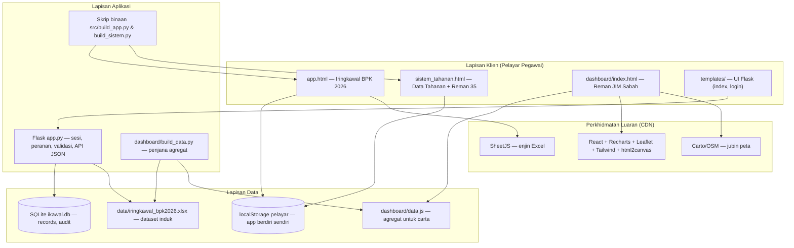

### 4.2 Tanggungjawab Komponen
| Komponen | Tanggungjawab | Teknologi |
|---|---|---|
| `app.py` | Sesi & peranan, validasi, CRUD rekod, import auto-clean, PDF (ReportLab), log audit, API JSON | Python, Flask, SQLite, openpyxl, reportlab |
| `templates/index.html`, `login.html` | UI pelayan (dashboard, borang log masuk) | HTML, CSS, JS |
| `app.html` | App berdiri sendiri: log masuk 3 peranan, 15 kolum data, CRUD, Laporan PDF, upload Excel, Devin | HTML/JS, SheetJS (embed) |
| `sistem_tahanan.html` | Data entry harian, senarai/filter, import Excel, cetak **Reman 35** (A4 Inggeris), Devin | HTML/JS, SheetJS (embed) |
| `dashboard/index.html` | Analitik Reman JIM Sabah (6 seksyen), penapis klik-carta, drill-down, eksport PNG/PDF, Devin | React, Recharts, Leaflet, Tailwind (CDN) |
| `dashboard/build_data.py` | Jana agregat sebenar daripada Excel ke `data.js` | Python, openpyxl |
| `src/build_app.py`, `src/build_sistem.py` | Bina semula HTML berdiri sendiri daripada templat + data + avatar | Python |

### 4.3 Corak & Prinsip
- **Satu sumber data:** dataset induk `data/iringkawal_bpk2026.xlsx`; Flask menyimpannya dalam SQLite.
- **Berdiri sendiri bila perlu:** HTML berdiri sendiri membenam data, SheetJS & avatar; berfungsi tanpa pelayan (guna `localStorage`).
- **Pemisahan binaan:** templat dalam `src/` → jana output HTML; jangan edit output terus.
- **Tiada data keluar:** semua analitik/AI dibuat setempat.

---

## 5. Reka Bentuk Data (ERD)

### 5.1 Skema SQLite (data rasmi)

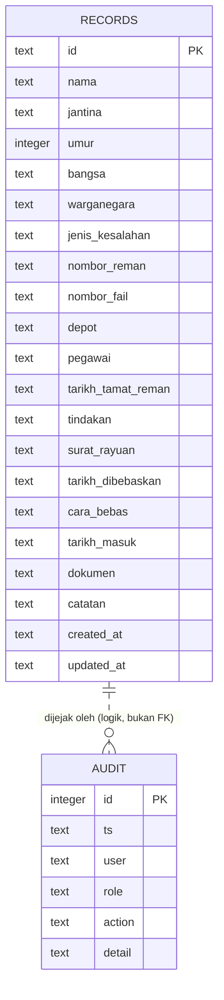

**Nota kardinaliti:**
- `records` : `audit` = **M : N logik** (setiap tindakan merekod log; setiap log merujuk rekod/pengguna tertentu melalui `detail`).

### 5.2 Definisi Jadual
| Jadual | Kolum | Keterangan |
|---|---|---|
| `records` | `id` (PK, TEXT) | UUID rekod |
| | `nama, jantina, umur, bangsa, warganegara` | Butiran tahanan |
| | `jenis_kesalahan, nombor_reman, nombor_fail, depot, pegawai` | Konteks kes |
| | `tarikh_masuk, tarikh_tamat_reman` | Tarikh (ISO `YYYY-MM-DD` selepas auto-clean) |
| | `tindakan, surat_rayuan, tarikh_dibebaskan, cara_bebas` | Status tindakan |
| | `dokumen, catatan` | Medan tambahan |
| | `created_at, updated_at` | Cap masa |
| `audit` | `id` (PK, AUTOINCREMENT) | Nombor log |
| | `ts, user, role, action, detail` | Cap masa, pengguna, peranan, tindakan, butiran |

**Indeks/Prestasi:** carian lazim pada `nombor_reman`, `nama`, `depot`, `tarikh_masuk` (disyorkan
indeks jika data membesar >50k rekod).

### 5.3 Model Data Tempatan (HTML berdiri sendiri & dashboard)
| Lokasi | Model | Keterangan |
|---|---|---|
| `localStorage` (`app.html`) | Senarai rekod 15 kolum + sesi pengguna | Tiada pelayan; kekal selepas muat semula |
| `localStorage` (`sistem_tahanan.html`) | Senarai rekod + tetapan borang Reman 35 | |
| `dashboard/data.js` | Objek agregat `REMAN_DATA` (KPI, piramid, pecahan, treemap, trend, heatmap, peta) | Dijana oleh `build_data.py` daripada Excel |

---

## 6. Aliran Proses (Sequence Diagrams)

### 6.1 Log Masuk & Kawalan Peranan (Flask)
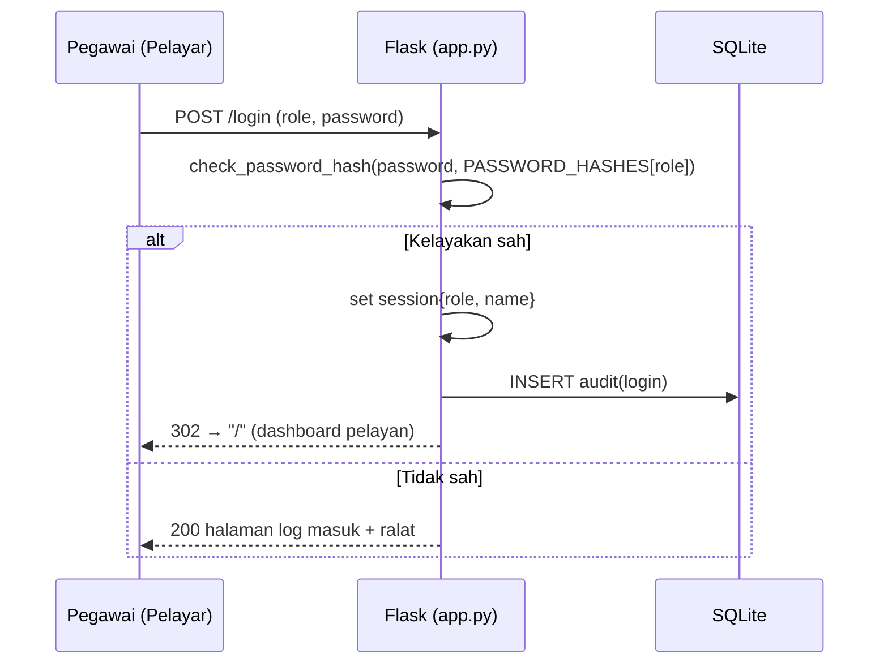

### 6.2 Import Excel dengan Auto-Clean
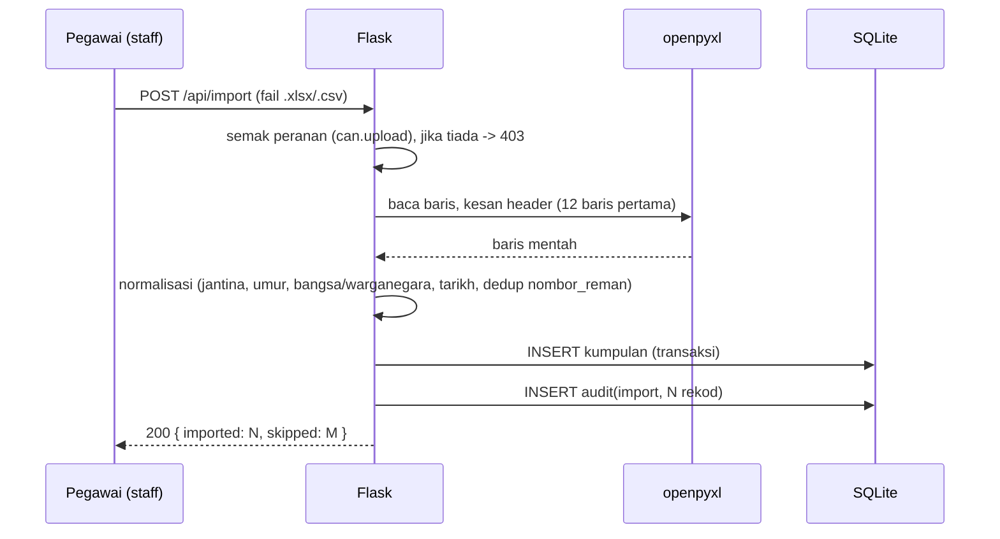

### 6.3 Tambah / Kemaskini / Padam Rekod
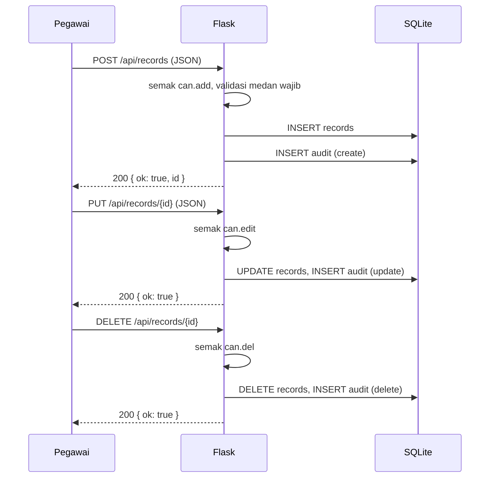

### 6.4 Jana Laporan PDF (Mengikut Penapis)
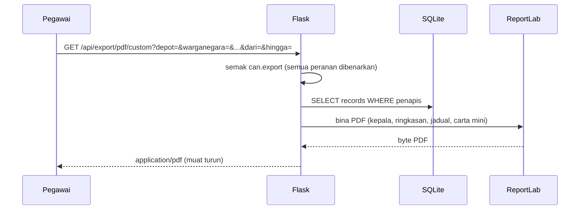

### 6.5 Cetak Reman 35 (Sisi-Klien, 100% Bahasa Inggeris)
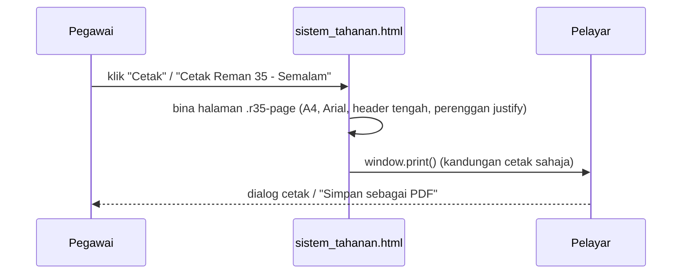

### 6.6 Muat Dashboard Reman JIM Sabah + Penapis + Devin
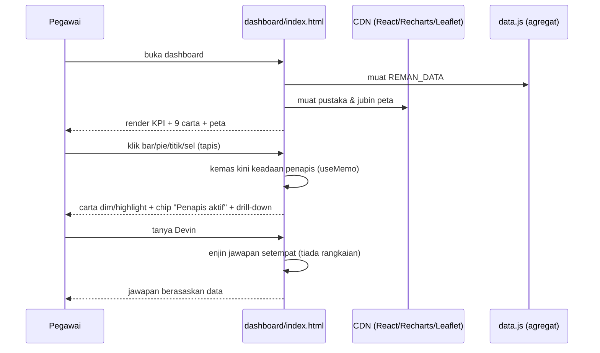

---

## 7. Kontrak API (Interface Contracts)

### 7.1 Ringkasan Endpoint
| Kaedah | Laluan | Kegunaan | Peranan |
|---|---|---|---|
| GET | `/api/me` | Sesi & kebenaran semasa | semua |
| GET | `/api/data` | Rekod + statistik + carta (`filter, q, officer, sort`) | semua |
| GET | `/api/options` | Pilihan penapis laporan tersuai | semua |
| POST | `/api/records` | Cipta rekod | staff |
| PUT/PATCH | `/api/records/{id}` | Kemas kini rekod | staff, penyelia |
| DELETE | `/api/records/{id}` | Padam rekod | staff |
| DELETE | `/api/records` | Kosongkan semua rekod | staff |
| POST | `/api/import` | Muat naik Excel/CSV (medan `file`) | staff |
| GET | `/api/export/pdf?period=` | Laporan PDF piawai | semua |
| GET | `/api/export/pdf/custom` | Laporan PDF ikut penapis | semua |
| GET/POST/DELETE | `/api/audit` | Log audit | mengikut peranan |

### 7.2 Contoh Request/Response
**POST `/api/records`**
```json
// Permintaan
{
  "nama": "ADNAL BIN JAILANI",
  "jantina": "LELAKI",
  "umur": 27,
  "bangsa": "BAJAU",
  "warganegara": "FILIPINA",
  "nombor_reman": "26(2096)BD",
  "nombor_fail": "(218)2026",
  "depot": "KOTA KINABALU",
  "pegawai": "TBK SITI NURAISYAH",
  "tarikh_masuk": "2026-11-23",
  "tarikh_tamat_reman": "2026-12-06",
  "tindakan": "USIR",
  "jenis_kesalahan": "SEK:15(1)(A) ADB 1952",
  "dokumen": "",
  "catatan": ""
}
// Respons (200 OK)
{ "ok": true, "id": "rec_9f3c1a" }
```

**GET `/api/me`**
```json
{ "authenticated": true, "role": "staff", "label": "Staff Iringkawal",
  "name": "PI YUSUF",
  "can": { "upload": true, "add": true, "edit": true, "del": true, "export": true } }
```

**Kod Status:** `200` berjaya; `400` input tidak sah; `401/403` tiada sesi / tiada kebenaran;
`404` rekod tiada; `500` ralat pelayan.

### 7.3 Spesifikasi OpenAPI (petikan)
```yaml
openapi: 3.0.3
info:
  title: IKAWAL API
  version: "1.0"
paths:
  /api/records:
    post:
      summary: Cipta rekod reman
      requestBody:
        required: true
        content:
          application/json:
            schema:
              $ref: '#/components/schemas/Record'
      responses:
        '200': { description: Berjaya }
        '403': { description: Tiada kebenaran (can.add=false) }
  /api/data:
    get:
      summary: Senarai rekod + statistik
      parameters:
        - { name: q, in: query, schema: { type: string } }
        - { name: depot, in: query, schema: { type: string } }
      responses:
        '200': { description: Berjaya }
components:
  schemas:
    Record:
      type: object
      required: [nama]
      properties:
        nama: { type: string }
        umur: { type: integer }
        tarikh_masuk: { type: string, format: date }
        depot: { type: string, enum: [KOTA KINABALU, PAPAR] }
```

---

## 8. Reka Bentuk Antara Muka (UI) & Komponen

### 8.1 Dashboard Reman JIM Sabah (6 seksyen)
| Seksyen | Kandungan | Sumber Data |
|---|---|---|
| 1. Penapis | Tarikh reman mula, Depot, Warganegara, Akta, Keseriusan, Pegawai, Tindakan, Set semula | `options` |
| 2. KPI | Jumlah reman (pie), Kadar USIR, Reman >14 hari, Kategori risiko | `kpi` |
| 3. Profil banduan | Piramid jantina×umur; taburan umur | `agePyramid`, `ageDistribution` |
| 4. Kesalahan×Warganegara | Pecahan warganegara; treemap warganegara→bangsa | `nationalityBars`, `treemap` |
| 5. Tindakan & Pegawai | Trend depot (DIKK/DIP); bubble beban×kualiti; heatmap akta×umur | `depotTrend`, `bubbles`, `aktaAge` |
| 6. Trend & Peta | Trend baharu vs >14 hari; peta asal→JIM Sabah | `monthlyReman`, `originMap` |

**Interaksi:** setiap bar/pie/titik/sel boleh diklik → menetapkan penapis + memaparkan **drill-down**;
tarikh menapis carta bulanan; eksport **PNG** & **Cetak/PDF**; **Devin** terapung.

### 8.2 Prinsip UI
- Tema korporat: navy `#0B2C4A`, kuning `#F2B705`, latar `#EEF2F7`, kad putih bersudut 16px.
- Responsive; carta `ResponsiveContainer`; jadual boleh skrol.
- Kebolehcapaian: label jelas, kontras memadai, ESC menutup popup.

---

## 9. Keselamatan & Audit

### 9.1 Matriks Kebenaran (Flask)
| Keupayaan | staff | penyelia | boss |
|---|---|---|---|
| Muat naik (import) | ✅ | ❌ | ❌ |
| Tambah rekod | ✅ | ❌ | ❌ |
| Kemas kini rekod | ✅ | ✅ | ❌ |
| Padam rekod | ✅ | ❌ | ❌ |
| Eksport PDF | ✅ | ✅ | ✅ |

### 9.2 Peranan App Berdiri Sendiri
| Peranan | Kebenaran |
|---|---|
| **ADMIN** | Semua: lihat, CRUD, upload, cetak PDF |
| **PENYELIA** | Lihat semua + cetak PDF; tiada ubah/upload |
| **PEGAWAI** | Hanya rekod miliknya (auto-tapis ikut Nama Pegawai); tiada ubah |

### 9.3 Kawalan Keselamatan
- **Kata laluan:** di-hash (`werkzeug.security`), boleh ganti melalui pemboleh ubah persekitaran (`IKAWAL_PW_STAFF/PENYELIA/BOSS`, `IKAWAL_SECRET`).
- **Sesi:** berasaskan cookie pelayan (Flask session).
- **Tiada kebocoran data:** Devin & semua analitik dibuat **setempat**; tiada API luar menerima data tahanan.
- **Audit tidak berubah (immutable log):** setiap tambah/kemas kini/padam/import/log masuk direkod ke jadual `audit` (300–400 entri terkini).
- **Cetakan terasing:** hanya kandungan borang dicetak (`@media print` menyembunyikan UI).
- **localStorage:** hanya peranti pengguna; tiada PII dihantar.

---

## 10. Pengendalian Kegagalan & Kebolehpercayaan

| Senario | Kesan | Pengendalian |
|---|---|---|
| Pangkalan data tidak dapat diakses | CRUD/API gagal | Pulangkan `500` + mesej; app berdiri sendiri terus berfungsi (localStorage) |
| Fail import cacat / header tak dikenali | Import gagal | Kesan header secara kata kunci; pulangkan mesej ralat; tiada penulisan separa (transaksi) |
| Talian CDN terputus (dashboard) | Pustaka tak dimuat | Papar mesej "Memuatkan…"; cadang serve tempatan; app HTML lain tidak terjejas |
| Jubin peta gagal | Peta kosong | Bulatan asal masih dipapar; eksport PNG gagal → **fallback ke Cetak/PDF** |
| Eksport PNG (html2canvas) CORS | Imej peta tak masuk | `useCORS: true` + fallback `window.print()` |
| Kuota localStorage penuh | Simpanan gagal | Tangkap ralat; maklumkan pengguna; data induk di Excel/DB kekal |
| Cetak popup disekat | Cetak gagal | Maklumkan pengguna benarkan popup |
| Data kosong selepas penapis | Carta kosong | Papar mesej "Tiada rekod"; benarkan "Set semula" |

---

## 11. Trade-Off & Keputusan Reka Bentuk

| Keputusan | Dipilih | Alternatif ditolak | Sebab |
|---|---|---|---|
| Pangkalan data | SQLite | PostgreSQL/MySQL | Cukup untuk skala depot; mudah alih, tiada pelayan DB |
| App berdiri sendiri | Satu fail HTML + SheetJS di-embed | SPA berpelayan sahaja | Boleh guna tanpa pelayan/internet (kecuali CDN dashboard) |
| Dashboard | React + Recharts + Leaflet via CDN | Build bundler (Vite/Webpack) | Tiada langkah binaan, cepat; boleh naik taraf ke bundler kemudian |
| AI (Devin) | Enjin setempat (peraturan) | LLM API pihak ketiga | Kepatuhan/kebocoran data — data tahanan tidak boleh keluar |
| Jana agregat | `build_data.py` pra-kira | Kira di pelayar setiap muat | Pantas, ringan, mudah audit angka |
| Keluaran templat | `src/` templat + skrip bina | Edit HTML output terus | Kebolehulangan & penyelenggaraan |
| Cetakan Reman 35 | Cetak pelayar (A4) | Penjana PDF pelayan | 1 tahanan = 1 helai; sepadan templat rasmi; mudah |

---

## 12. Rancangan Ujian & Kriteria Penerimaan

| # | Kes Ujian | Langkah | Jangkaan |
|---|---|---|---|
| T1 | Import Excel | Muat naik dataset induk | Bilangan rekod betul; kolum dipetakan; tiada ralat |
| T2 | Kekal selepas refresh | Tambah rekod → muat semula | Rekod kekal (localStorage/DB) |
| T3 | Cetak Reman 35 | Cetak seorang tahanan | 1 helai A4, 100% Inggeris, header tengah, perenggan justify |
| T4 | Cetak pukal semalam | Pilih tarikh dengan data → cetak dipilih | N helai (1/orang), susunan betul |
| T5 | Laporan PDF penapis | Tetapkan penapis → Pratonton/Cetak | Kandungan = hanya rekod ditapis; jumlah betul |
| T6 | Kebenaran peranan | Log masuk sebagai penyelia/boss | Butang ubah/upload tersembunyi; API pulangkan 403 |
| T7 | Klik carta (dashboard) | Klik bar/pie/titik/sel | Penapis ditetapkan; chip "Penapis aktif"; drill-down muncul |
| T8 | Penapis tarikh (dashboard) | Tukar julat bulan | Bulan luar julat dikeluarkan dari carta trend |
| T9 | Devin | "Berapa orang Filipina?" | Jawapan angka sebenar; tiada panggilan rangkaian |
| T10 | Agregat sebenar | Jalankan `build_data.py` | KPI sepadan data (2,114; Filipina 1,740; USIR 96.9%; >14 hari 201) |

---

## 13. Kebolehskalaan & Prestasi

- **Matlamat:** < 25s untuk sediakan + cetak satu batch reman; memuat dashboard < 3s (dengan CDN).
- **SQLite:** memadai sehingga ~50k rekod; tambah indeks pada `nombor_reman`, `tarikh_masuk`, `depot`.
- **Dashboard:** agregat pra-kira dalam `data.js` (bukan kira per muat); carta `useMemo`.
- **Import:** pukal dalam transaksi tunggal.

---

## 14. Kepatuhan & Privasi

- Data tahanan ialah **data peribadi sensitif** — disimpan setempat (peranti/pelayan dalaman).
- **Tiada penghantaran keluar**: Devin, eksport dan analitik berjalan setempat; hanya CDN pustaka (bukan data) diakses untuk dashboard.
- Rekod audit menyokong akauntabiliti pegawai.

---

## 15. Senarai Semak Pra-Kod (Checklist)

- [ ] **PRD Diluluskan** — peraturan/polisi dikunci.
- [ ] **Sistem Dipetakan** — seni bina + sequence dilukis (§4, §6).
- [ ] **Data & API Sedia** — ERD + kontrak API/OpenAPI (§5, §7).
- [ ] **TDD Ditandatangani** — risiko + fallback disahkan (§10, §11, §16).

---

## 16. Risiko & Mitigasi

| Risiko | Kebarangkalian | Impak | Mitigasi |
|---|---|---|---|
| Data tidak konsisten (header/format) | Sederhana | Tinggi | Auto-clean + laporan baris dilangkau |
| Kebergantungan CDN (dashboard) | Sederhana | Sederhana | Serve tempatan; boleh vendorkan pustaka |
| Android/IE pelayar lama | Rendah | Sederhana | Sasaran pelayar moden (Chrome/Edge) |
| PII terdedah melalui eksport | Rendah | Tinggi | Fail setempat; kawalan peranan; tiada egress |
| Prestasi dengan data besar | Rendah | Sederhana | Indeks SQLite; agregat pra-kira |

---

## 17. Lampiran

### 17.1 Glosari
| Istilah | Maksud |
|---|---|
| PRD | Product Requirements Document — Apa & Mengapa |
| TDD | Technical Design Document — Bagaimana |
| ERD | Entity-Relationship Diagram — reka bentuk pangkalan data |
| Sequence Diagram | Gambaran aliran interaksi merentas sistem mengikut masa |
| Auto-clean | Pembersihan automatik semasa import |
| Reman 35 | Notis Seksyen 35 Akta Imigresen 1959/63 |
| Devin | Pembantu AI setempat dalam sistem |

### 17.2 Peta Fail Projek
```text
IKAWAL/
├─ app.py                       # Backend Flask + SQLite + import + PDF + audit
├─ templates/
│  ├─ index.html                # Dashboard pelayan
│  └─ login.html                # Log masuk pelayan
├─ app.html                     # App berdiri sendiri (Iringkawal BPK 2026)
├─ sistem_tahanan.html          # Data tahanan + cetak Reman 35
├─ reman35_contoh.html          # Contoh borang
├─ devin.png                    # Avatar Devin
├─ dashboard/
│  ├─ index.html                # Dashboard Reman JIM Sabah
│  ├─ data.js                   # Agregat (dijana)
│  └─ build_data.py             # Penjana agregat
├─ src/                         # Sumber binaan (templat + skrip)
├─ data/iringkawal_bpk2026.xlsx # Dataset induk (2,115 baris)
├─ ikawal.db                    # SQLite (dijana)
└─ requirements.txt
```

### 17.3 Rujukan
- Deck latihan: *Spec-Driven Development for Immigration Systems* (PRD, TDD, seni bina, ERD, sequence, API/OpenAPI).
- `README.md` projek IKAWAL.
- Kod sumber: `app.py`, `dashboard/build_data.py`, `dashboard/index.html`.

---

## 18. Lampiran B — Galeri Carta & Graf

Semua carta di bawah dijana daripada **data sebenar** (`dashboard/data.js`, sumber
`data/iringkawal_bpk2026.xlsx`) dan sepadan dengan carta interaktif dalam *Dashboard
Reman JIM Sabah* (`dashboard/index.html`). Diagram aliran, ERD dan sequence diagram
pula terdapat dalam **Bahagian 4–6**. Peta asal-warganegara ialah peta interaktif
Leaflet (hanya dalam dashboard, bukan imej statik).

### 18.1 KPI
**Pecahan Warganegara (Donut)** — Filipina mencatat ~82%.
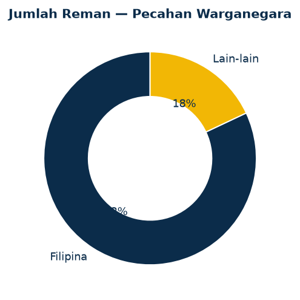

**Kategori Risiko Kes Terbuka**
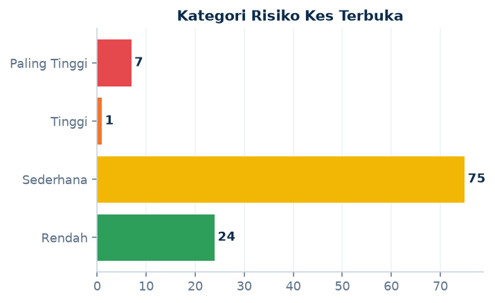

**Pecahan Keseriusan Kes**
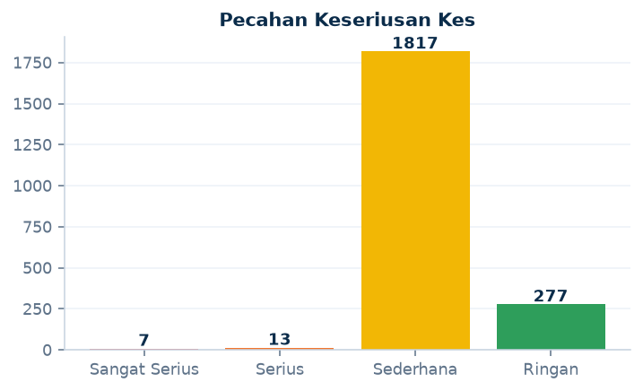

### 18.2 Profil Banduan
**Piramid Jantina & Kumpulan Umur**
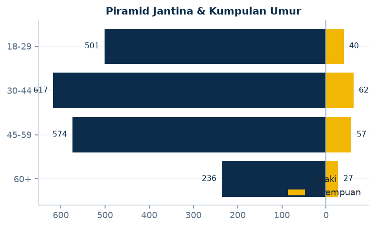

**Taburan Umur**
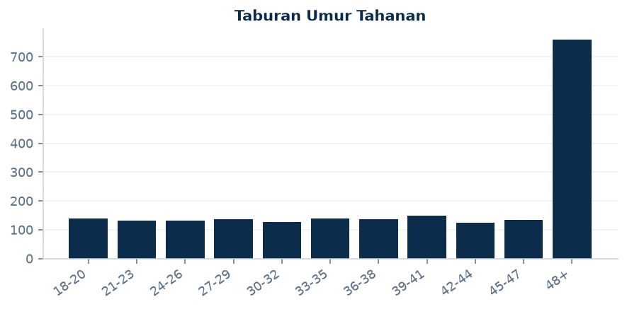

### 18.3 Kesalahan × Warganegara
**Pecahan Warganegara (Bar)**
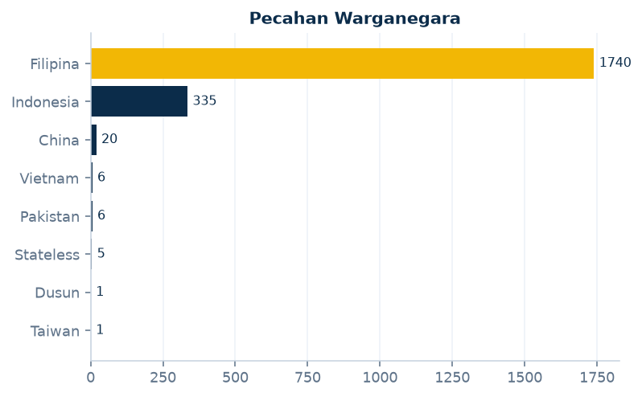

**Warganegara → Bangsa (Treemap)**
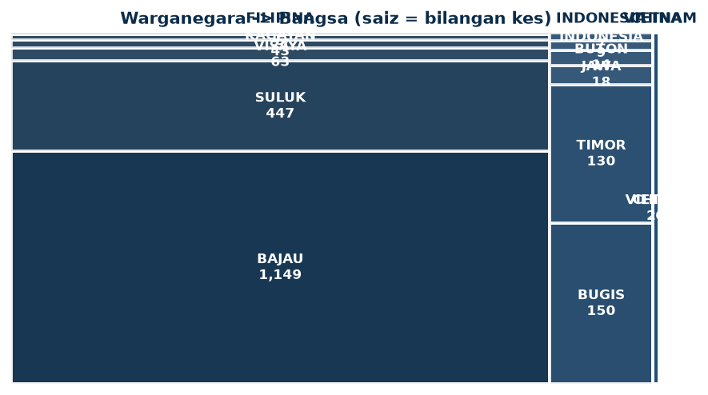

### 18.4 Tindakan & Pegawai
**Trend Reman Mengikut Depot (DIKK vs DIP)**
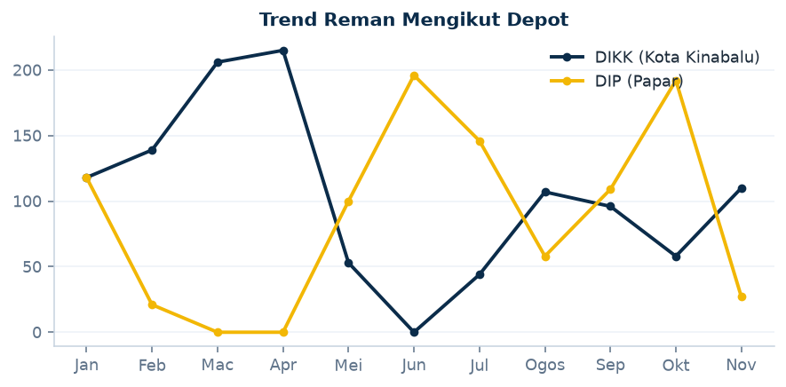

**Korelasi Beban Kes & Kualiti Data (Bubble)**
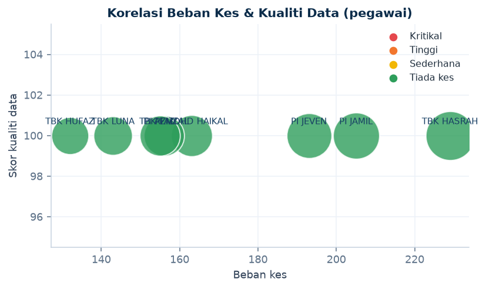

**Akta × Kumpulan Umur (Heatmap, % dalam setiap akta)**
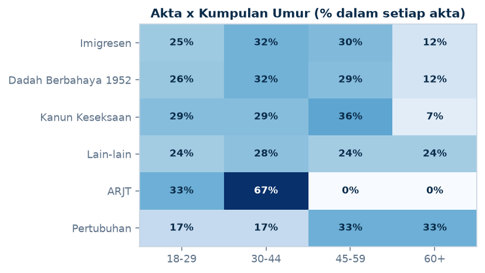

### 18.5 Trend
**Reman Baharu & Lanjutan (>14 hari) Mengikut Bulan**
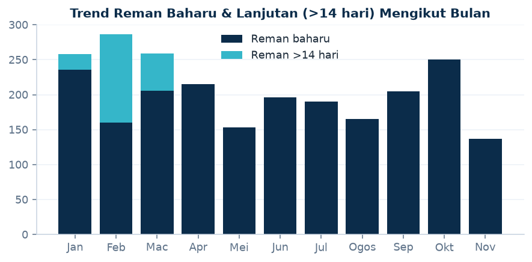

---

**Tamat dokumen.** — *Design First. Build With Confidence.*
