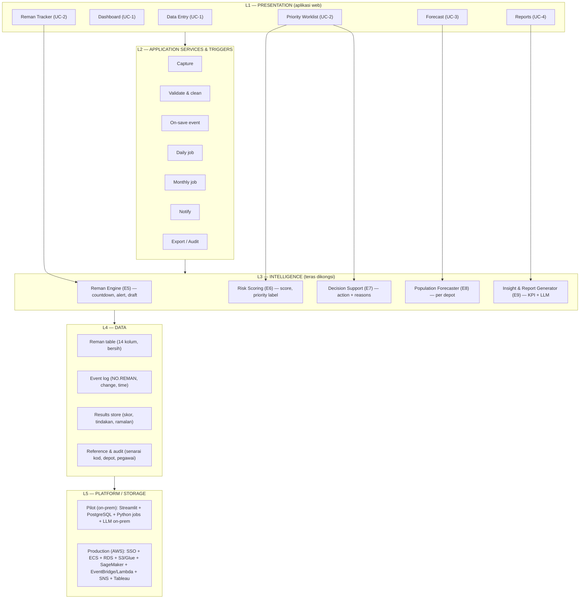
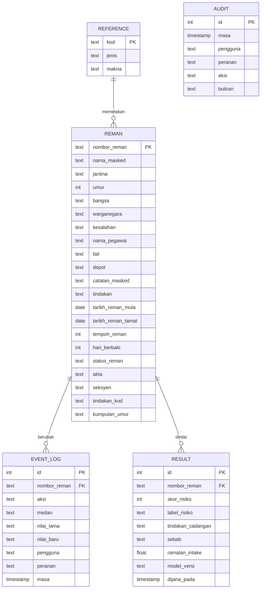
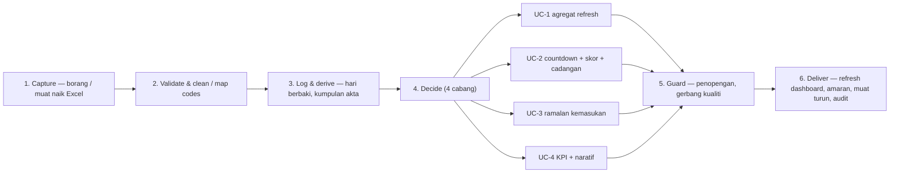
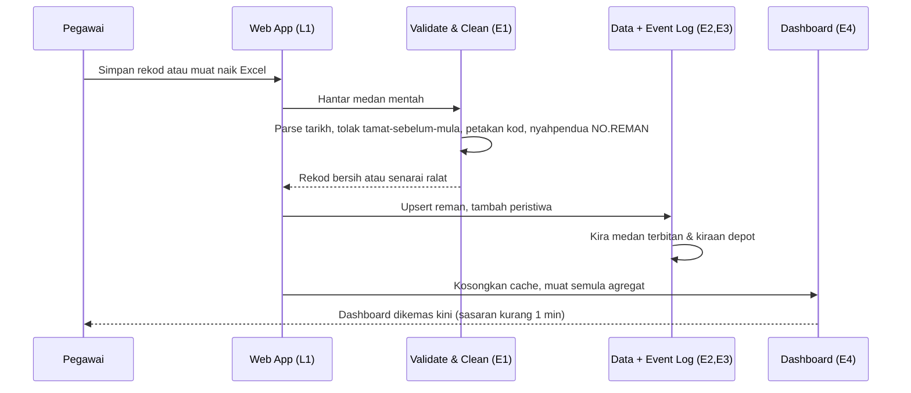
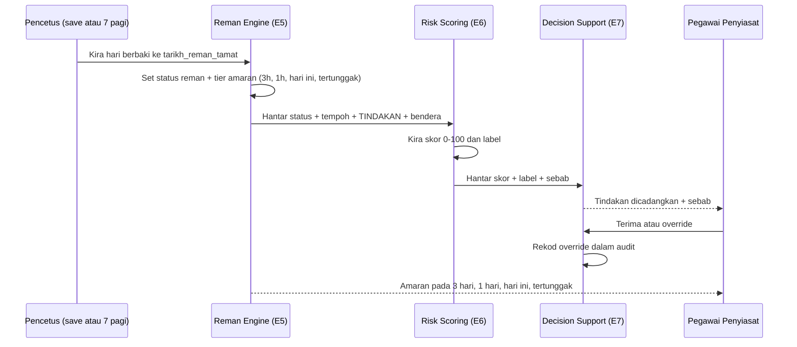
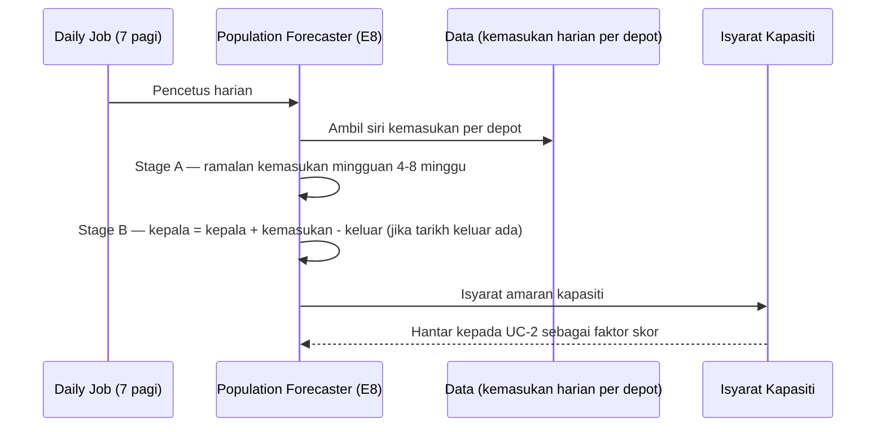
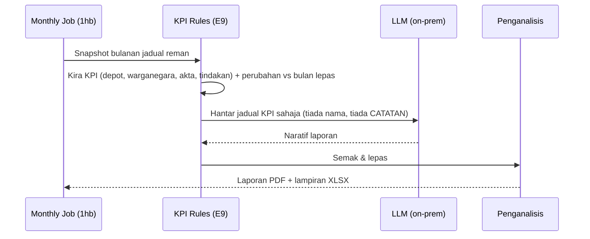
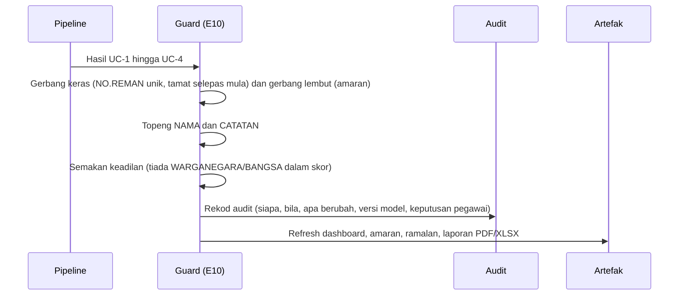

# TDD — IKAWAL: Pemantauan Banduan Dagang & Sokongan Keputusan
## Dokumen Reka Bentuk Teknikal (Technical Design Document)

> **TDD = Technical Design Document** (menjawab **BAGAIMANA** sistem dibina).
> Disusun mengikut prinsip *Spec-Driven Development* dan **berdasarkan sepenuhnya**
> dokumen *Use Cases & Pipeline — IKAWAL (v3)* (kes penggunaan UC-1 hingga UC-4,
> elemen E1–E10, seni bina 5 lapisan, saluran 6 peringkat).

---

## 0. Kawalan Dokumen

| Perkara | Maklumat |
|---|---|
| Tajuk | TDD IKAWAL — Pemantauan Banduan Dagang & Sokongan Keputusan |
| Versi | 1.0 |
| Tarikh | 27 November 2026 |
| Pemilik Teknikal | Jurutera Sistem / Pembangun IKAWAL |
| Pihak Berkepentingan | Pegawai reman/depot, pegawai penyiasat, Ketua Depot, Pengurusan HQ, Unit Perundangan, ICT |
| Rujukan | *Ikawal_usecase_pipeline_v3.html*; dataset `iringkawal_BPK_2026` (2,115 baris); `README.md`; `app.py`; `dashboard/` |
| Skop data | 14 kolum sumber · Jan–Dis 2026 · depot DIKK & DIP |
| Status | Draf untuk semakan |

### Rekod Semakan
| Versi | Tarikh | Perubahan |
|---|---|---|
| 1.0 | 27/11/2026 | Versi pertama — mengikuti kes penggunaan UC-1..UC-4 & saluran IKAWAL v3 |

---

## 1. Ringkasan & Skop

**Masalah:** Daftar reman disimpan sebagai satu helaian Excel per tempoh. Tarikh tamat reman
dipantau dengan mata, tiada cara konsisten melihat kes mana perlu diutamakan, kesesakan depot
hanya disedari selepas berlaku, dan laporan bulanan/briefing dibina semula setiap kitaran.

**Penyelesaian (IKAWAL):** Gantikan helaian dengan **borang kemasukan berstruktur** +
**dashboard langsung** di atas **teras AI yang dikongsi**. Setiap kali rekod reman ditaip atau
dikemas kini, kiraan detik reman, label risiko, cadangan tindakan dan dashboard **dikemas kini
secara automatik**. Semua output AI bersifat **nasihat** sahaja — pegawai yang memutuskan.

**Empat kes penggunaan:**

| ID | Kes Penggunaan | Output Utama | Teknik Teras | Pencetus |
|---|---|---|---|---|
| **UC-1** | Interactive Monitoring Dashboard (+ kemasukan data) | Dashboard 6 halaman + borang kemasukan | Validasi, pembersihan, segar semula dipacu-peristiwa | Pada simpan/naik naik |
| **UC-2** | Case Decision Support (reman automatik + keutamaan risiko) | Reman tracker, senarai keutamaan, tindakan dicadangkan | Enjin peraturan + skor + recommender | Pada simpan + harian |
| **UC-3** | AI Depot Population Forecasting | Ramalan kemasukan / bilangan kepala | Siri masa (moving average / SARIMA / Prophet) | Harian |
| **UC-4** | AI Insight & Automated Report Generator | Laporan bulanan (PDF/XLSX); infografik kemudian | Peraturan KPI + naratif LLM | Bulanan (1hb) |

**Skop dalam dokumen ini:** reka bentuk teknikal (seni bina, data, aliran, kontrak, keselamatan,
kegagalan, trade-off) untuk UC-1 hingga UC-4 dan saluran hujung-ke-hujung.
**Luar skop:** pengendapan AWS penuh, penalaan model ML lanjutan, integrasi IMoS/Interpol.

---

## 2. Katalog Kes Penggunaan

### UC-1 — Interactive Monitoring Dashboard (dengan kemasukan data)
- **Masalah:** Daftar reman satu helaian panjang; jumlah ikut depot/warganegara/kesalahan/pegawai dikira tangan.
- **Aktor:** Pegawai reman/depot (kemasukan), pegawai penyiasat, Ketua Depot, pengurusan HQ.
- **Input:** 14 kolum sumber (borang atau muat naik Excel); medan terbitan; hasil UC-2 & UC-3.
- **Pendekatan:** Borang (E1) dengan dropdown + pemilih tarikh, semakan pendua `NO.REMAN`, jadual pemetaan untuk muat naik; simpan & terbit (E2, E3); dashboard segar pada setiap simpan (E4).
- **Output:** Dashboard interaktif 6 halaman (lihat §5.1) dengan penapis, penapisan-silang, drill-down ke senarai kes bertopeng, eksport PNG/XLSX.
- **KPI:** masa simpan → dashboard (sasaran < 1 min); % rekod lulus validasi; `NO.REMAN` kosong (sasaran 0).

### UC-2 — Case Decision Support (Reman Automatik + Keutamaan Risiko)
- **Masalah:** Tarikh tamat reman dipantau dengan mata (boleh terlepas); tiada cara konsisten melihat kes mana perlu diutamakan atau apa tindakan seterusnya.
- **Aktor:** Pegawai penyiasat (`NAMA PEGAWAI`), Ketua Depot, Unit Perundangan.
- **Input:** Tempoh reman, `NO.REMAN`, `KESALAHAN`, `TINDAKAN`, bendera `CATATAN`, `UMUR`, `DEPOT`; kemudian `TARIKH TANGKAP`, `STATUS KES`, `DOKUMEN`, kiraan lanjutan.
- **Pendekatan:** Rantai tiga langkah pada setiap simpan dan setiap pagi:
  - **E5 Enjin reman** — bilangan hari berbaki ke `tarikh_reman_tamat`; amaran kepada pegawai pada 3 hari, 1 hari, hari ini dan tertunggak; draf dokumen lanjutan/penutup pra-isi.
  - **E6 Skor risiko** — skor 0–100 → **Kritikal / Tinggi / Sederhana / Rendah** dengan sebab utama (§10). v2 menambah kebarangkalian ML.
  - **E7 Sokongan keputusan** — satu tindakan dicadangkan; pegawai terima atau override (override direkod).
- **Output:** Reman tracker, senarai keutamaan ikut pegawai/depot, tindakan dicadangkan, draf dokumen, amaran harian.
- **KPI:** reman sampai tamat tanpa `TINDAKAN` (sasaran 0); % Kritikal ditangani dalam 24 jam; kadar penerimaan cadangan.

### UC-3 — AI Depot Population Forecasting
- **Masalah:** Lonjakan kemasukan & kesesakan hanya disedari selepas berlaku.
- **Aktor:** Operasi HQ; Ketua Depot.
- **Input:** Sekarang — kemasukan reman baharu harian per `DEPOT`; kelompok `FAIL`. Kemudian — `TARIKH USIR/KELUAR` & kapasiti depot.
- **Pendekatan:** **E8 Stage A** (data semasa) — ramalan kemasukan mingguan per depot 4–8 minggu (baseline moving-average; SARIMA/Prophet/GBR pada lag + ciri kalendar). **Stage B** (selepas tarikh keluar direkod) — bilangan kepala = kepala sebelum + kemasukan − keluar, dengan jalur keyakinan & amaran kapasiti.
- **Output:** Ramalan kemasukan per depot (Stage A); ramalan kepala & isian + senarai amaran (Stage B); isyarat kapasiti kepada UC-2.
- **KPI:** ralat ramalan (MAPE); bilangan hari amaran sebelum pelanggaran kapasiti.

### UC-4 — AI Insight & Automated Report Generator
- **Masalah:** Laporan bulanan & carta briefing dibina tangan; angka dan naratif tidak konsisten & lewat.
- **Aktor:** Penganalisis data; pengurusan HQ.
- **Input:** Snapshot bulanan jadual reman; hasil UC-2; ramalan UC-3.
- **Pendekatan:** Kerja berjadual pada 1hb → KPI (ikut depot, warganegara, kumpulan akta, tindakan; perubahan vs bulan lepas) → **E9 peraturan insight** → **LLM menulis naratif daripada jadual KPI sahaja** (tiada nama, tiada `CATATAN`) → penganalisis semak & lepas.
- **Output:** Laporan bulanan (PDF + lampiran XLSX). Kemudian: infografik pecahan warganegara, kesalahan setiap warganegara, sebab >14 hari.
- **KPI:** laporan siap pada hari bekerja ke-2; ketidakpadanan angka (sasaran 0).

### 2.1 Ringkasan Kes Penggunaan
| ID | Output | Pencetus | Berjalan atas data semasa? |
|---|---|---|---|
| UC-1 | Dashboard 6 halaman + borang | Pada simpan | Ya |
| UC-2 | Reman tracker, worklist, cadangan | Pada simpan + harian | Ya (v1) |
| UC-3 | Ramalan kemasukan / kepala | Harian | Kemasukan: ya; kepala: perlu tarikh keluar |
| UC-4 | Laporan bulanan; infografik kemudian | Bulanan | Ya |

---

## 3. Elemen Penyelesaian (E1–E10)

| ID | Elemen | Apa ia |
|---|---|---|
| **E1** | Kemasukan & pengingesan data | Borang mencerminkan 14 kolum (dropdown WARGANEGARA, BANGSA, DEPOT, NAMA PEGAWAI, KESALAHAN, TINDAKAN; dua pemilih tarikh reman) + muat naik Excel dengan jadual pembersihan/pemetaan. |
| **E2** | Simpan & log peristiwa | Jadual reman bersih berki `NO.REMAN` + log tambah-sahaja bagi setiap perubahan. |
| **E3** | Lapisan ciri | Medan terbitan (§5.2): hari berbaki, panjang reman, kumpulan akta, kod tindakan, kumpulan umur, bendera ulang, kiraan harian per depot. |
| **E4** | Dashboard interaktif | Halaman, penapis, penapisan-silang & drill-down (UC-1); segar pada setiap simpan. |
| **E5** | Enjin reman | Kiraan detik ke `tarikh_reman_tamat`, tier amaran, draf dokumen lanjutan/penutup. |
| **E6** | Skor risiko | Skor keutamaan 0–100 → Kritikal/Tinggi/Sederhana/Rendah, dengan sebab; versi ML kemudian. |
| **E7** | Sokongan keputusan | Satu tindakan seterusnya dicadangkan per kes; pegawai terima/override; override direkod. |
| **E8** | Forecaster populasi | Ramalan kemasukan per depot (kini) & ramalan kepala (selepas tarikh keluar wujud). |
| **E9** | Penjana insight & laporan | Peraturan KPI + naratif LLM daripada angka terkira sahaja; PDF/XLSX bulanan; infografik kemudian. |
| **E10** | Audit, akses & eksport | Peranan (officer / depot head / HQ), audit trail, penopengan `NAMA` & `CATATAN`, muat turun. |

---

## 4. Seni Bina Sistem (5 Lapisan)

UC-1 berada di atas; elemen AI duduk dalam **teras dikongsi (L3)**.



> **Nota pematuhan:** pengehosan mesti mengikut peraturan data-residency & klasifikasi kerajaan —
> sahkan sebelum memilih awan. Semua ciri `NAMA` dan `CATATAN` **ditopeng** dalam dashboard dan
> **tidak pernah** dihantar ke LLM.

---

## 5. Reka Bentuk Data

### 5.1 Jadual Sumber (14 kolum) & Isu Kualiti
| Kolum | Format | Digunakan oleh | Isu (fail dummy) |
|---|---|---|---|
| TARIKH TAMAT REMAN | `DD.MM.YYYY-DD.MM.YYYY` | UC-1,2,4 | Dua tarikh dalam satu sel; 41 baris tamat sebelum mula; 1 kosong |
| NAMA | teks | UC-1 | PII — perlu ditopeng |
| JANTINA | LELAKI/PEREMPUAN | UC-1,4 | 26 baris nombor/simbol |
| UMUR (THN) | integer | UC-1,2,4 | 18–65, tiada kosong |
| BANGSA | BAJAU, SULUK, ... | UC-1,4 | 32 nilai (varian ejaan) |
| WARGANEGARA | FILIPINA, INDONESIA | UC-1,4 | 20 nilai (ruang depan, kod PHL, gabungan) |
| NO.REMAN | `26(nnnn)BD` | Semua | 256 kosong; 2 pendua |
| DOKUMEN | NIL | UC-2 | Selalu NIL |
| NAMA PEGAWAI | pangkat + nama | UC-1,2 | 29 pegawai; 5 kosong |
| FAIL | `(nn)2026` | UC-1,3 | Ruang depan; 5 kosong |
| DEPOT | DIKK / DIP | Semua | 1 "NIL", 5 kosong |
| CATATAN | teks bebas | UC-2 | 97% kosong; bendera berguna; kadang no. kad pengenalan (PII) |
| TINDAKAN | USIR, BEBAS DENGAN AMARAN | UC-1,2,4 | 56 ejaan (~6 hasil); sebahagian belum muktamad |
| KESALAHAN | Akta + seksyen | UC-1,2,4 | 88 ejaan (contoh `6(1)( C ) Immg`) |

### 5.2 Medan Terbitan (dikira sistem)
| Medan terbitan | Cara | Digunakan oleh |
|---|---|---|
| `tarikh_reman_mula`, `tarikh_reman_tamat` | Pisah `TARIKH TAMAT REMAN` pada `-`, parse `DD.MM.YYYY`; dua pemilih tarikh semasa kemasukan | Semua |
| `tempoh_reman`, `hari_berbaki` | tamat − mula + 1 (14 hari dalam 92% baris); tamat − hari ini | UC-1,2 |
| `status_reman` | Aktif / tamat 3 hari / tamat hari ini / tertunggak / selesai | UC-1,2 |
| `akta`, `seksyen` | Normalisasi `KESALAHAN` → kumpulan akta (Imigresen 1959/63, Dadah Berbahaya 1952, Kanun Keseksaan, Kastam, lain-lain) + kod seksyen bersih | UC-1,2,4 |
| `tindakan_kod` | Peta `TINDAKAN` → USIR / +BLI / +RAI / BATAL PAS / BEBAS DENGAN AMARAN / BELUM MUKTAMAD | UC-1,2,4 |
| `kumpulan_umur`, `flag_ulang` | 18–29/30–44/45–59/60+; bendera ulang daripada kata kunci `CATATAN` | UC-1,2 |

### 5.3 ERD



### 5.4 Medan Baharu untuk Reka Bentuk Penuh
| Medan baharu | Mengapa perlu | Menjejaskan |
|---|---|---|
| `TARIKH TANGKAP` | Hari ditahan sebelum reman; kiraan 14 hari sebenar | UC-2 |
| `TARIKH USIR/KELUAR` | Tanpa ini isian depot & masa-ke-deport tidak boleh diukur | UC-1,3 |
| `STATUS KES` | Siasatan / reman / dituduh / dihukum / menunggu usir / diusir / dibebaskan | UC-2,4 |
| `BIL LANJUTAN REMAN` | Kiraan lanjutan | UC-2 |
| `SEBAB LEBIH 14 HARI` | Sebab berkod untuk infografik & sokongan keputusan | UC-2,4 |
| `DOKUMEN` (berisi), `STATUS KEDUTAAN` | Penyekat utama deportasi | UC-2 |
| Kapasiti depot (jadual rujukan) | % isian & amaran kapasiti | UC-1,3 |

---

## 6. Saluran Hujung-ke-Hujung (Pipeline, 6 Peringkat)



| Peringkat | Apa berlaku | Komponen |
|---|---|---|
| 1 Capture | Kemasukan borang atau muat naik Excel (header dikesan; ruang depan nama kolum dipangkas) | E1 |
| 2 Validate & clean | Pisah/parse tempoh reman; tolak tamat-sebelum-mula; pangkas & petakan WARGANEGARA/TINDAKAN/KESALAHAN melalui jadual kod; tanda bukan-jantina; wajib & nyahpendua `NO.REMAN` | E1 |
| 3 Log & derive | Upsert jadual reman; tambah peristiwa; kira medan terbitan & kiraan depot harian | E2, E3 |
| 4 Decide | UC-1 agregat; UC-2 countdown/skor/cadangan; UC-3 ramalan; UC-4 KPI+naratif | E4, E9 |
| 5 Guard | Kelulusan pegawai, skor bolehjelas, semakan keadilan, gerbang kualiti, penopengan | E10 |
| 6 Deliver | Refresh dashboard, maklum pegawai, hasilkan muat turun, tulis audit | E10 |

**Jadual pencetus:** pada simpan/muat naik → segar UC-1 + UC-2; **harian 07:00** → amaran UC-2 + ramalan UC-3; **bulanan 1hb** → laporan UC-4 + latihan semula.

---

## 7. Aliran (Sequence Diagrams)

### 7.1 UC-1 — Simpan/Muat Naik → Pembersihan → Terbit → Segar Dashboard


### 7.2 UC-2 — Rantai Per-Kes (E5 → E6 → E7) + Amaran Harian


### 7.3 UC-3 — Ramalan Harian


### 7.4 UC-4 — Laporan Bulanan (KPI + Naratif LLM)


### 7.5 Gerbang Guard & Deliver (Penopengan + Audit)


---

## 8. Kontrak Antara Muka (API / Komponen)

| Elemen | Operasi | Input | Output |
|---|---|---|---|
| E1 | `POST /records`, `POST /import` | Rekod 14 kolum / fail Excel | Rekod bersih, senarai ralat |
| E2/E3 | `GET /records` | Penapis | Rekod + medan terbitan |
| E4 | `GET /dashboard` | Penapis (tarikh, depot, warganegara, akta, pegawai, tindakan) | Agregat + siri (untuk 6 halaman) |
| E5 | `GET /reman/{no_reman}` | `NO.REMAN` | Hari berbaki, status, tier amaran |
| E6 | `GET /risk/{no_reman}` | `NO.REMAN` | Skor 0–100, label, sebab |
| E7 | `GET /recommendation/{no_reman}` | `NO.REMAN` | Tindakan dicadangkan, sebab |
| E7 | `POST /recommendation/{no_reman}/decision` | `accept` atau `override` + sebab | Rekod keputusan |
| E8 | `GET /forecast?depot=` | Depot, horizon | Siri ramalan + jalur keyakinan |
| E9 | `GET /report?month=` | Bulan | Laporan PDF/XLSX + jadual KPI |
| E10 | `GET /audit` | Penapis | Rekod audit |

**Contoh `GET /risk/{no_reman}`:**
```json
{
  "nombor_reman": "26(2096)BD",
  "skor": 75,
  "label": "Kritikal",
  "sebab": [
    "Reman tamat dalam 2 hari, TINDAKAN belum muktamad",
    "Tempoh reman melebihi 14 hari (lanjutan)",
    "Umur 60 tahun ke atas (rentan)"
  ],
  "model_versi": "rules-v1"
}
```

**Contoh `GET /recommendation/{no_reman}`:**
```json
{
  "nombor_reman": "26(2096)BD",
  "label": "Kritikal",
  "tindakan_cadangan": "Act today: rekod TINDAKAN (usir / bebas) atau mohon lanjutan; eskalasi kepada Ketua Depot.",
  "perlu_kelulusan_pegawai": true
}
```

**Kod status:** `200` berjaya · `400` input tidak sah · `403` tiada peranan · `404` rekod tiada · `422` gagal validasi · `500` ralat.

---

## 9. Spesifikasi Enjin Reman (E5)

- **Bilangan hari berbaki** = `tarikh_reman_tamat − hari ini`.
- **`status_reman`:** Aktif · Tamat 3 hari · Tamat hari ini · Tertunggak · Selesai (bila `tindakan_kod` muktamad).
- **Tier amaran** kepada pegawai bernama: **3 hari · 1 hari · hari ini · tertunggak**.
- **Draf dokumen** (DOCX/PDF) pra-isi untuk lanjutan/penutup — pegawai semak & hantar; sistem **tidak pernah** memfailkan automatik.

---

## 10. Spesifikasi Skor Risiko (E6) — v1 (data semasa)

| Faktor risiko | Sumber | Mata |
|---|---|---|
| Reman tamat hari ini / tertunggak, TINDAKAN belum muktamad | tempoh reman, TINDAKAN | +40 |
| Reman tamat dalam 1–3 hari, TINDAKAN belum muktamad | tempoh reman, TINDAKAN | +25 |
| TINDAKAN belum muktamad (UJIAN DNA, RAYUAN, kosong) | TINDAKAN | +15 |
| Tempoh reman melebihi 14 hari (lanjutan) | tempoh reman | +10 |
| Kes berulang (TANGKAP SEMULA / TAHAN SEMULA) | CATATAN | +10 |
| Umur 60 tahun ke atas (rentan) | UMUR | +10 |
| Jurang admin: `NO.REMAN` atau `FAIL` kosong | NO.REMAN, FAIL | +10 |
| Ramalan depot melebihi 90% kapasiti | UC-3 | +5 |

**Label & tindakan:**

| Label | Skor | Tindakan disyorkan |
|---|---|---|
| **Kritikal** | ≥ 60 | Hari ini: rekod TINDAKAN atau mohon lanjutan; eskalasi ke Ketua Depot. |
| **Tinggi** | 35–59 | Dalam 48 jam: sediakan draf lanjutan atau tutup langkah DNA/rayuan. |
| **Sederhana** | 15–34 | Minggu ini: betulkan jurang admin; sahkan pengaturan deportasi. |
| **Rendah** | < 15 | Pantau. |

> **Guard keadilan:** `WARGANEGARA` dan `BANGSA` **bukan** faktor skor. Taburan skor disemak merentas
> kewarganegaraan setiap bulan. Pemberat & potongan adalah cadangan awal untuk persetujuan Ketua Depot & Unit Perundangan.

---

## 11. Spesifikasi Sokongan Keputusan (E7)
- Satu tindakan dicadangkan per kes daripada gabungan countdown + label risiko + `tindakan_kod`.
- Pegawai **terima** atau **override**; setiap keputusan direkod (siapa, bila, sebab).
- Tiada tindakan automatik difailkan.

---

## 12. Spesifikasi Ramalan (E8)
- **Stage A (kini):** ramalan kemasukan mingguan per depot untuk 4–8 minggu (baseline moving-average; tingkat ke SARIMA/Prophet/GBR), ciri: lag + kalendar.
- **Stage B (selepas tarikh keluar):** `kepala_t = kepala_{t-1} + kemasukan_t − keluar_t`; ramalan dengan jalur keyakinan + amaran kapasiti.
- Output isyarat kapasiti disuap balik ke UC-2 (+5 mata risiko jika >90%).

---

## 13. Spesifikasi Insight & Laporan (E9)
- KPI bulanan: reman ikut depot, warganegara, kumpulan akta, tindakan; **perubahan vs bulan lepas**.
- **LLM menulis naratif daripada jadual KPI sahaja** — tiada nama, tiada `CATATAN`.
- Penganalisis semak & lepas; angka boleh dijejak; lampiran XLSX disertakan.

---

## 14. Keselamatan, Akses & Audit (E10)

| Peranan | Lihat | Kemasukan | Kemas kini | Eksport | Lulus laporan |
|---|---|---|---|---|---|
| Officer (remus/depot) | Ya (topeng) | Ya | Ya | Ya | — |
| Depot Head | Ya (topeng) | — | Semak/eskalasi | Ya | — |
| HQ Management | Ya (agregat) | — | — | Ya | Ya |
| Penganalisis data | Ya (topeng) | — | — | Ya | Ya (lulus) |

- **Penopengan:** `NAMA` & `CATATAN` ditopeng dalam dashboard dan **tidak dihantar** ke LLM.
- **Audit record:** siapa, bila, apa berubah, versi model, cadangan, keputusan pegawai (jadual `audit`/`event_log`).
- **Data-residency:** sahkan keperluan kerajaan sebelum memilih awan.

---

## 15. Pengendalian Kegagalan & Kebolehpercayaan

| Senario | Kesan | Pengendalian |
|---|---|---|
| `NO.REMAN` kosong / pendua | Kunci rosak | Gerbang keras tolak; pegawai betulkan |
| Tamat sebelum mula (typo tahun) | Panjang reman salah | Gerbang keras tolak; senarai kualiti data (halaman 6) |
| Ejaan `TINDAKAN`/`KESALAHAN` pelbagai | Agregat salah | Jadual pemetaan kod; senarai belum dipetakan |
| LLM tidak tersedia | Naratif tiada | Laporan tetap dijana dengan KPI; naratif templat disediakan |
| Ramalan melebihi kapasiti | Risiko kesesakan | Amaran kapasiti + +5 mata risiko UC-2 |
| `TARIKH KELUAR` tiada | Kepala tidak dapat diukur | Stage B dilangkau; amaran "tidak lengkap" |
| Override terlalu kerap | Skor tidak tepat | Log override untuk kalibrasi; semakan bulanan |

---

## 16. Trade-Off & Keputusan Reka Bentuk

| Keputusan | Dipilih | Alternatif ditolak | Sebab |
|---|---|---|---|
| Enjin risiko v1 | Peraturan berwajaran | ML terus | Boleh jalan dari hari pertama atas kolum semasa |
| Dashboard | Streamlit + Plotly (pilot) | Binâ tangan penuh | Pantas; boleh tukar ke Tableau di produksi |
| Naratif AI | LLM on-prem atas jadual KPI | LLM awan atas data mentah | Privasi: tiada PII keluar |
| Pangkalan data | PostgreSQL | Excel | Kunci, pendua, log peristiwa, kueri agregat |
| Pembersihan | Jadual pemetaan kod | Auto-teka bebas | Konsisten & boleh audit |
| Kelulusan | Pegawai lulus setiap draf | Automasi penuh | Akauntabiliti; sistem tidak memfailkan sendiri |

---

## 17. Ujian & Kriteria Penerimaan

| # | UC | Kes Ujian | Jangkaan |
|---|---|---|---|
| T1 | UC-1 | Simpan rekod baru | Dashboard segar < 1 min; rekod kelihatan |
| T2 | UC-1 | Muat naik Excel | Rekod dibersihkan; baris cacat ditolak + disenaraikan |
| T3 | UC-1 | Klik bar carta | Seluruh halaman ditapis; drill-down ke senarai bertopeng |
| T4 | UC-2 | Kes tamat 2 hari, TINDAKAN kosong | Skor ≥ 60 → Kritikal; amaran + cadangan "Act today" |
| T5 | UC-2 | Kes ulang + umur 60+ | +10 +10 pada skor; sebab dipapar |
| T6 | UC-2 | Override cadangan | Keputusan + sebab direkod |
| T7 | UC-3 | Jalankan tugasan harian | Ramalan kemasukan per depot + MAPE dipapar |
| T8 | UC-3 | Depot > 90% kapasiti | Isyarat amaran; +5 ke UC-2 |
| T9 | UC-4 | Jalankan tugasan bulanan | Laporan PDF/XLSX; angka sepadan KPI; tiada PII dalam naratif |
| T10 | E10 | Akses HQ | Papar agregat bertopeng; `NAMA`/`CATATAN` tersembunyi |
| T11 | Qaliti | Baris tamat-sebelum-mula | Ditolak oleh gerbang keras |

---

## 18. Susunan Bina (Waves) & Soalan Terbuka

| Wave | Skop | Elemen | Implikasi |
|---|---|---|---|
| **1** | UC-1: jadual kod, pembersihan fail 2026, borang, dashboard 1–6 | E1 E2 E3 E4 E10 | Data bersih + dashboard langsung dahulu |
| **2** | UC-2 v1: countdown, skor peraturan, cadangan, amaran | E5 E6 E7 | Jalan atas kolum semasa dari hari pertama |
| **3** | UC-4 laporan bulanan; UC-3 Stage A ramalan kemasukan | E8 E9 | Kedua-dua atas kolum semasa |
| **4** | Tambah medan baharu (§5.4) | E6 E8 E9 | Perlu tarikh keluar, status, sebab untuk beberapa bulan |

**Soalan terbuka:** (1) bolehkah borang tambah `TARIKH TANGKAP`, `TARIKH USIR/KELUAR`, `STATUS KES`, `SEBAB LEBIH 14 HARI`, kiraan lanjutan? (2) senarai kod rasmi TINDAKAN (BLI, RAI) & KESALAHAN? (3) peraturan reman (tempoh standard, lanjutan, siapa lulus, lead time amaran)? (4) pemberat risiko & potongan label? (5) kapasiti DIKK/DIP, pengehosan, alat dashboard?

---

## 19. Pemetaan kepada Pelaksanaan Semasa (repo IKAWAL)

| Elemen IKAWAL | Status dalam repo IKAWAL |
|---|---|
| E1 kemasukan & pengingesan | Sebahagian — borang 15 kolum + muat naik Excel dalam `app.html`; auto-clean dalam `app.py` (`/api/import`) |
| E2 simpan & log peristiwa | Ya — SQLite `records` + `audit` dalam `app.py` |
| E3 lapisan ciri (terbitan) | Sebahagian — kumpulan akta, kumpulan umur, status reman dikira dalam halaman **Analitik Reman** & `dashboard/build_data.py` |
| E4 dashboard interaktif | Ya — halaman **Analitik Reman** dalam `app.html` (penapis, penapisan carta, drill-down, peta) |
| E5 enjin reman | Sebahagian — halaman **Cetak Reman 35** & senarai reman; belum hasilan amaran berjadual |
| E6 skor risiko | Belum — dicadangkan dalam TDD ini |
| E7 sokongan keputusan | Belum — dicadangkan |
| E8 forecaster | Belum — dicadangkan |
| E9 insight & laporan | Sebahagian — Laporan PDF + Jana Ringkasan AI dalam `app.html` |
| E10 audit, akses & eksport | Sebahagian — peranan & audit (Flask); eksport PDF |

---

## 20. Lampiran

### 20.1 Peta Teknik
| Keupayaan | Teknik | Pustaka | UC |
|---|---|---|---|
| Pembersihan & validasi | Jadual pemetaan kod, regex | pandas / pandera | UC-1 |
| Dashboard | Penapis, cross-filter, drill-down | Streamlit + Plotly / Tableau | UC-1 |
| Reman automatik | Peraturan tarikh + tier + templat | pandas/SQL, python-docx | UC-2 |
| Skor risiko | v1 berwajaran; v2 gradient boosting + SHAP | scikit-learn/XGBoost/shap | UC-2 |
| Sokongan keputusan | Peraturan atas countdown + skor + TINDAKAN | Python rule engine | UC-2 |
| Ramalan populasi | Moving average → SARIMA/Prophet/GBR | statsmodels/prophet | UC-3 |
| Insight & laporan | KPI + naratif LLM atas jadual KPI | LLM on-prem/Bedrock; ReportLab/openpyxl | UC-4 |

### 20.2 Glosari
| Istilah | Maksud |
|---|---|
| Reman | Tempoh tahanan sebelum keputusan |
| Banduan dagang | Tahanan warga asing |
| DIKK / DIP | Depot Kota Kinabalu / Papar |
| BLI / RAI | Kod tindakan (rujukan unit perundangan) |
| PII | Maklumat pengenalan peribadi |
| MAPE | Ralat peratus mutlak purata |

### 20.3 Rujukan
- *Use Cases & Pipeline — IKAWAL (v3)* (`Ikawal_usecase_pipeline_v3.html`).
- Dataset `iringkawal_BPK_2026` (14 kolum, 2,115 baris).
- `README.md`, `app.py`, `dashboard/build_data.py` (repo IKAWAL).

---

**Tamat dokumen.** — *Design first, kemudian bina dengan yakin.*
