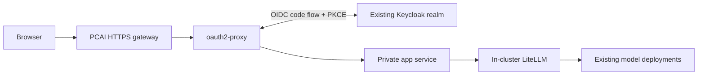

# PCAI plugin for OpenCode

Install the native OpenCode v2 plugin, create a LiteLLM app, and prepare a Helm chart for PCAI. This HPE-PCAI folder is independent of the parent Gemini workshop.

## Install the plugin on Windows

1. Extract the complete ZIP. Use Python 3.11+ and OpenCode **v2.3.2 or newer within v2**.
2. Double-click **Install PCAI Plugin.cmd**. The installer copies the key-free bundle to your OpenCode global plugin folder and leaves your model/provider settings intact.
3. Fully quit and reopen **OpenCode PCAI**. Type **/pcai-help**.
4. In a workspace where you want a new project, type **/pcai-start my-team-app**. Open the created folder as your project.

| Command | Outcome |
|---|---|
| `/pcai-help` | Explain the plugin and available workflows. |
| `/pcai-start` | Create a new app folder using the scaffold tool. |
| `/pcai-build` | Build and verify a feature using the app-dev skill. |
| `/pcai-review` | Review effects on APIs, models and deployment. |
| `/pcai-deploy` | Prepare PCAI deployment artifacts; live changes remain explicit actions. |
| `/pcai-check` | Diagnose LiteLLM model access and review acceptance evidence. |

The plugin registers `pcai_status`, `pcai_guide` and `pcai_scaffold`, plus the seven skills below. It uses the native v2 server plugin API and requires no separate npm dependency installation. See [plugin details](docs/plugin.md).

Open **PCAI-Plugin-Explained.html** for the 14-slide presentation. It works offline with arrow-key navigation, **O** for overview and **N** for speaker notes.

The starter includes a browser chat, two fictional reports, bounded report-reading tools and Markdown download. Conversations stay in the browser tab. It has no database, uploads, persistent user files or background jobs. Extend those deliberately when your app needs them.

## Run the starter app

1. Extract the complete pack. Keep this folder together.
2. Install Python 3.11 or newer if IT has not installed it. Use the official [Python installer](https://www.python.org/downloads/windows/).
3. Connect to the PCAI VPN.
4. In LiteLLM, create a virtual key without selecting a team (or ensure the key explicitly allows DeepSeek). Double-click **Setup App.cmd**, choose a model by number, then paste your own LiteLLM key. Each pasted character appears as `*` so you can see the input was received.
5. Double-click **Run App.cmd**. Open **http://127.0.0.1:8000** when the console shows the address.
6. Ask: **Compare the North and South pilots. What needs clarification?** Then click **Download answer (.md)**.

The first run downloads Python packages. Later runs reuse the virtual environment. Setup stores your key privately under `.local/`; it is never part of the sharing archive. Press Enter at the model prompt to keep the current default. Press Enter at the key prompt to keep a saved key. After setup reports **SETUP COMPLETE**, double-click **Run App.cmd**. Stop the app with Ctrl+C. See [LiteLLM setup and troubleshooting](docs/litellm.md) if a request says the model was not found.

## UC-2: Case Decision Support

This build adds UC-2 from the SmartDepot design: an automated reman countdown, a 0-100 risk score with
reasons, and one recommended next action per banduan dagang case. The app shows a **Priority worklist**
and answers case questions in the chat using read-only tools. No LiteLLM key is needed to see the
worklist; the chat still needs one.

How it works:

- `app/xlsx.py` reads the register with the standard library only, so the hash-locked image needs no
  new dependency.
- `app/reman.py` is the pure rule engine (countdown, score, label, action, name masking). Weights and
  cut-offs follow document sections 5.2 and 5.3.
- `app/store.py` locates the workbook and builds scored cases (cached by file mtime).
- `app/main.py` serves `GET /api/uc2/summary`, `GET /api/uc2/cases` (filters `label`, `depot`,
  `officer`, `status`, `q`, `open`, `limit`) and `GET /api/uc2/case/{NO.REMAN}`.
- `app/agent.py` exposes `reman_summary`, `list_priority_cases` and `get_case` to tool-capable models.
  Names are masked and `CATATAN` is never returned.

The register is found, in order, at `APP_REMAN_FILE`, then the first `.xlsx` in `data/`, `app/data/`,
`.local/`, and finally the shared repo-level `../data/`. By default it reads the same
`data/iringkawal_bpk2026.xlsx` the Flask app uses, so both apps share one source. Both register shapes
work: the `start-end` range in one cell, and the BPK 2026 layout with a single `TARIKH TAMAT REMAN`
plus `TARIKH MASUK`. With no register present the endpoints return `503` with a hint. Run the checks
with `python -m pytest tests` (from a normal console, so the workshop-wizard test can read the keyboard).

Use the [Windows LiteLLM connection installer](https://drive.google.com/file/d/1KyB38QRVmWw2hZV6CtbpHVN8fF7q_h-6/view) already supplied for OpenCode's model connection. The app setup and OpenCode setup are separate: each needs its own configuration. No Gemini key is required for this folder. Keep installed plugin files as references; develop inside the scaffolded project.

## Develop with reusable skills

Say: **Use agentic-app-dev to add [my feature]. Read AGENTS.md, implement it and verify the complete user flow.**

| Skill | Purpose |
|---|---|
| `agentic-app-dev` | Build a feature from request through a working UI and meaningful checks. |
| `pcai-deploy` | Prepare Helm, Keycloak, image, Secrets, rollout and acceptance artifacts. |
| `pstack-how` | Trace the existing implementation before changing it. |
| `pstack-architect` | Decide ownership, interfaces and state for substantial changes. |
| `pstack-blast-radius` | Check callers, contracts and deployment effects outside a diff. |
| `pstack-debug` | Reproduce failures and fix their cause. |
| `pstack-prove` | Verify actual behavior and artifacts before claiming completion. |

These are project skills under `.opencode/skills/`. The pstack skills are an attributed, portable subset, not the full Cursor plugin. See [attribution](third-party/pstack/NOTICE.md).

Playwright MCP and Context7 MCP are supplied **disabled** so the app works without Node.js, additional logins or external MCP access. Enable them when needed with **Enable Workshop Tools.cmd** and [MCP setup](docs/mcp.md). GitHub MCP remains optional for teams using pull requests.

## Prepare deployment artifacts

An attendee can develop the app locally. A platform operator needs the registry, Docker or an approved image builder, Helm 3, kubectl, an authorized kubeconfig, and a Keycloak client.

| Command | Result |
|---|---|
| **Check Setup.cmd** | Check prerequisites without printing credentials. |
| **Configure PCAI.cmd** | Collect the app hostname, registry, namespace, context, issuer, client, group and credentials. No file editing. |
| **Build Image.cmd** | Build a Linux amd64 image. Offer to push it to your registry. |
| **Prepare PCAI Secrets.cmd** | Apply two app-scoped Secrets to the selected context and namespace. |
| **Prepare PCAI Import.cmd** | Render manifests and generate `.local/pcai-app-0.1.0.tgz` with filled non-secret values. |
| **Deploy PCAI.cmd** | Alternative CLI installation or upgrade with Helm. Do not use this to manage a release owned by the PCAI UI. |

For the supplied environment, open [PCAI Import Framework](https://home.htp-ai-ai-application.awanheitech.local/frameworks/import). Select `assets/app-icon.png`, upload the generated `.tgz`, and select the same project namespace used for the Secrets. The live import screen showed `project-genai-platform` during preparation; confirm your team's project.

Read [deploy to PCAI](docs/deploy.md) and [configure Keycloak](docs/keycloak.md) before importing. The pack does not create or change a Keycloak realm, shared gateway, DNS entry or TLS certificate.

## Deployment shape

Istio VirtualService is the default. Standard Kubernetes Ingress is also supported. Both route to oauth2-proxy. The app service remains private behind NetworkPolicy. The app calls existing models, so this chart requests CPU and memory, not GPUs.

## Reuse and validation

Copy this folder for another team or project. Change the UI and tools, use unique image tags and release names, then rerun configuration. Share only a fresh ZIP generated by `python scripts/package.py`; do not zip a working folder containing `.local/`.

Use [development commands](docs/develop.md), [acceptance checks](docs/acceptance.md), [artifact templates](artifacts/) and the [validation record](docs/validation.md).

This is a workshop starter. Platform deployment remains unaccepted until the real registry pull, gateway routing, Keycloak allowed/denied users, NetworkPolicy and LiteLLM calls pass in the target PCAI project. The current environment's cluster version, gateway policy and Keycloak client settings have not been inferred from the portal URL.
