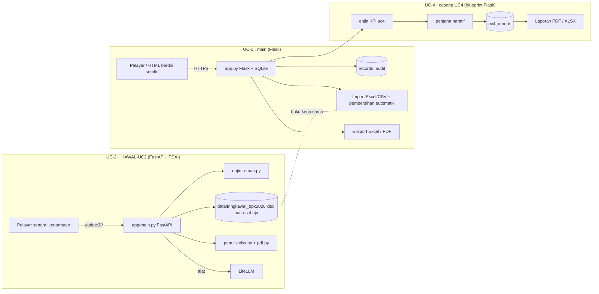
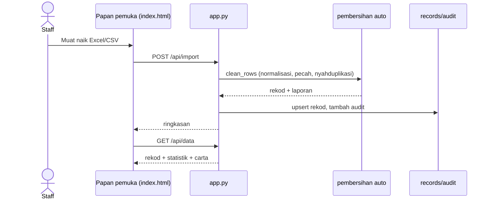
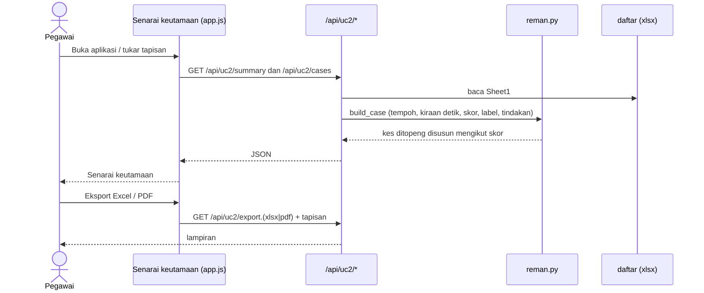
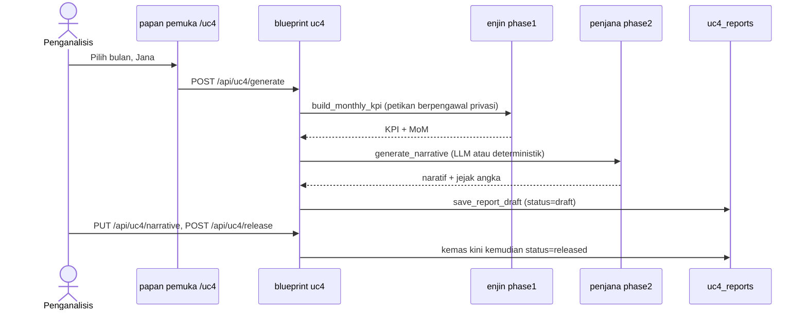
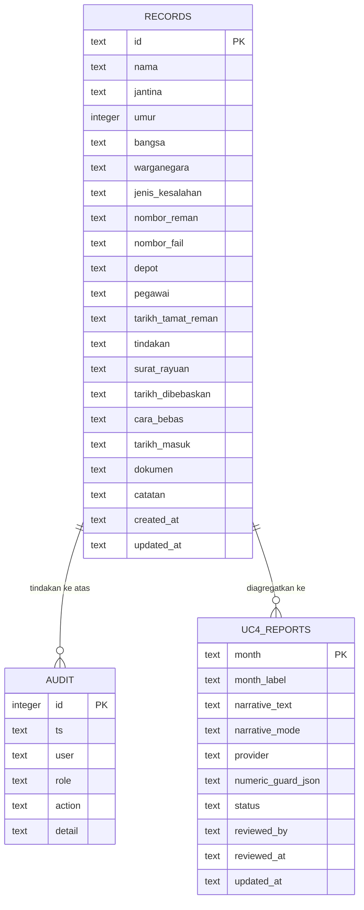

# Dokumen Reka Bentuk Teknikal (TDD): IKAWAL / SmartDepot — Pemantauan dan Sokongan Keputusan Banduan Dagang

| Medan | Butiran |
| :--- | :--- |
| **ID Dokumen** | `TDD-IKAWAL-001` |
| **Status** | Draf untuk semakan |
| **Jenis dokumen** | Dokumen Reka Bentuk Teknikal — TDD ini menerangkan **bagaimana** sistem dibina; ia **bukan** Test-Driven Development. |
| **PRD berkaitan** | `PRD-IKAWAL-001` — *Pengurusan Data Tahanan & Reman BPK 2026* (dijangka daripada `Ikawal_usecase_pipeline_v3.html`) |
| **Rujukan tutorial** | `Spec-Driven Development for Immigration Systems.pdf` / `.pptx` dan `tdd_imm_001_digital_arrival_border_clearance.md` |
| **Pemilik** | Kejuruteraan Sistem; Operasi Imigresen BPK |
| **Penyemak** | Ketua Dasar, Keselamatan, Pemilik Data (BPK), Operasi Depot, Pengurusan Rekod |
| **Skop** | Seluruh program: `main` serta setiap cabang kes penggunaan (`IKAWAL-UC2`, `UC4`). Status `UC-1` dan `UC-3` direkodkan. |
| **Kemas kini terakhir** | 2026-11-27 |

## 1. Tujuan dan prinsip reka bentuk

Dokumen ini ialah kontrak pelaksanaan bagi program IKAWAL. Ia menerangkan jambatan semasa antara reka
bentuk kes penggunaan yang diluluskan (`Ikawal_usecase_pipeline_v3.html`) dengan kod yang wujud pada
setiap cabang: papan pemuka Flask pada `main`, perkhidmatan sokongan keputusan UC-2 pada `IKAWAL-UC2`,
dan penjana laporan bulanan UC-4 pada `UC4`.

Ia mengikut jujukan dipacu spesifikasi tutorial:

1. **Takrif (Define)** dasar dan hasil yang boleh diukur dalam PRD.
2. **Reka (Design)** seni bina, jujukan, model data dan kontrak API di sini.
3. **Setuju (Agree)** kes tepi, kawalan keselamatan dan tingkah laku ganti dengan pegawai dan penyemak.
4. **Bina (Build)** hanya terhadap kontrak yang telah disemak dan diversikan.

Prinsip reka bentuk:

- **Satu rekod, satu kebenaran:** daftar reman (`records`) ialah sumber tunggal; papan pemuka,
  sokongan keputusan, laporan dan eksport semuanya membacanya.
- **Kurangkan pendedahan:** hanya medan yang diperlukan pegawai dipaparkan atau dikembalikan; nama
  tahanan ditopeng dan `catatan` tidak pernah meninggalkan pelayan bagi laluan model atau eksport.
- **Jadikan keputusan boleh dijejaki:** setiap tulisan dan setiap laporan yang dijana direkodkan dalam
  jejak `audit`; UC-4 memisahkan `draft` daripada `released`.
- **Asingkan dasar daripada pengangkutan:** hasil diwakili oleh kod `status` / sebab yang eksplisit,
  bukan disimpulkan daripada status HTTP semata-mata.
- **Utamakan tingkah laku deterministik yang boleh disemak:** skor UC-2 ialah peraturan, bukan model;
  naratif UC-4 jatuh balik kepada templat deterministik dan setiap angka dijejaki kembali ke petikan KPI.
- **Permukaan runtime minimum bagi setiap cabang:** perkhidmatan UC-2 tidak menambah **sebarang**
  kebergantungan runtime melebihi permulaan PCAI (penulis `.xlsx`/PDF daripada pustaka piawai).

## 2. Skop dan keperluan

### 2.1 Objektif program

Memberi pegawai dan penyelia BPK satu pandangan yang boleh dipercayai tentang tahanan asing di bawah
reman (*banduan dagang*), menandakan secara automatik kes yang perlu tindakan, meramal tekanan depot,
dan menghasilkan laporan bulanan — sambil mengekalkan data peribadi ditopeng dan setiap tindakan boleh
diaudit.

### 2.2 Kes penggunaan, cabang dan status pelaksanaan

| Kes penggunaan | Rujukan reka bentuk | Cabang | Teknologi | Status |
| :--- | :--- | :--- | :--- | :--- |
| **UC-1** Papan Pemuka Pemantauan Interaktif (+ kemasukan data) | `Ikawal_usecase_pipeline_v3.html` §5 UC-1 | `main` | Flask + SQLite + UI templat + aplikasi HTML berdiri sendiri | Dilaksanakan (tiada ujian automatik) |
| **UC-2** Sokongan Keputusan Kes (kiraan detik reman + skor risiko + tindakan disyorkan) | §5 UC-2, §6 saluran | `IKAWAL-UC2` | FastAPI (permulaan PCAI) + pustaka piawai xlsx/pdf | Dilaksanakan + diuji |
| **UC-3** Peramalan Populasi Depot AI | §5 UC-3 | *(tiada)* | — | **Tidak dilaksanakan.** Hanya rangka penyesuai UC-2/UC-3 dalam UC-4 |
| **UC-4** Penjana Insight & Laporan Automatik AI | §5 UC-4 | `UC4` | Blueprint Flask + SQLite + LLM (pilihan) | Dilaksanakan + diuji |

### 2.3 Keperluan produk → respons reka bentuk

| Keperluan (PRD) | Respons reka bentuk | Ukuran penerimaan |
| :--- | :--- | :--- |
| Ganti daftar Excel yang dijaga tangan | Jadual `records` disemai daripada `data/iringkawal_bpk2026.xlsx` dengan pembersihan automatik | Larian pertama mengimport buku kerja terbina dan melaporkan bilangan baris |
| Lihat gambaran tanpa kiraan manual | Papan pemuka pelayan (`templates/index.html`) + agregat `/api/data` | Kad KPI dan carta sepadan dengan set data |
| Kenal pasti kes yang perlu tindakan dahulu | Kiraan detik UC-2 + skor risiko + tindakan disyorkan | Senarai keutamaan disusun mengikut skor; setiap kes ada sebab |
| Jauhkan data peribadi | Penopengan, `catatan` dikecualikan daripada model/eksport; pengawal PII dalam UC-4 | Eksport dan gesaan LLM tiada nama mentah/`catatan` (disahkan oleh ujian) |
| Hasilkan laporan bulanan dengan pasti | Petikan KPI UC-4 → naratif → PDF/XLSX, `draft` kemudian `released` | Angka dijejaki ke petikan; pelancaran oleh penganalisis diperlukan |
| Berfungsi luar talian / dalam kluster | UC-2 berjalan pada permulaan PCAI; aplikasi HTML berdiri sendiri berfungsi tanpa pelayan | `app.html`, `sistem_tahanan.html`, `reman35_contoh.html` dibuka terus |

### 2.4 Dalam skop

- Papan pemuka UC-1, CRUD rekod, import Excel/CSV dengan pembersihan automatik, eksport Excel/PDF, log audit, peranan.
- Papan pemuka HTML berdiri sendiri untuk luar talian yang dibina daripada templat `src/`.
- Sokongan keputusan UC-2 baca-sahaja ke atas daftar, serta eksport Excel/PDF/CSV bagi senarai keutamaan.
- Petikan KPI bulanan UC-4, naratif LLM/ganti, aliran kerja draf/pelancaran, eksport PDF/XLSX.

### 2.5 Di luar skop

- Peramalan UC-3 (tiada cabang); biometrik; integrasi e-Gate; pemprosesan visa.
- Persekutuan pengesahan identiti dengan IdP pusat untuk `main` (peranan kata laluan tempatan sahaja);
  UC-2 bergantung pada corak oauth2-proxy PCAI (tidak diuji secara tempatan).
- Pelaksanaan kluster sebenar bagi mana-mana cabang (artifak wujud untuk UC-2 sahaja).

## 3. Pelaku, andaian dan istilah

### 3.1 Pelaku

| Pelaku | Tanggungjawab |
| :--- | :--- |
| Staff Iringkawal (`staff`) | Muat naik/import, tambah, sunting, padam rekod, eksport, baca UC-2, jana UC-4. |
| Penyelia (`penyelia`) | Sunting dan eksport; lihat UC-2 dan UC-4; tiada padam/muat naik. |
| Boss (`boss`) | Lihat dan eksport sahaja. |
| Pemilik Data BPK | Sahkan medan baharu, senarai kod, pengekalan. |
| Pegawai penyiasat (`pegawai`) | Pemilik bernama bagi sesuatu kes; menerima item senarai keutamaan UC-2. |
| LLM (LiteLLM) | Balasan sembang UC-2 dan naratif UC-4 (pilihan); tidak pernah berautoriti. |

### 3.2 Andaian yang perlu disahkan

- Data bersifat **dummy/terbitan** untuk bengkel; pengendalian data peribadi sebenar dan pengekalan
  memerlukan kelulusan.
- Daftar kanonik ialah `data/iringkawal_bpk2026.xlsx` (2,199 baris × 15 lajur). UC-2 juga menerima
  bentuk 14 lajur `mula–tamat`.
- Titik hujung LLM UC-4 adalah pilihan; sifat deterministik diperlukan apabila ia tidak tersedia.
- `main` berjalan pada `127.0.0.1:5000`; UC-2 pada `127.0.0.1:8000`.

### 3.3 Istilah

- **Reman** — tempoh tahanan reman. **Banduan dagang** — tahanan asing. **Depot** — DIKK / DIP.
- **TDD** dalam dokumen ini = Dokumen Reka Bentuk Teknikal.

## 4. Seni bina peringkat tinggi

Tiga hasil yang boleh dijalankan secara berasingan berkongsi satu set data dan satu stor audit (di mana
pangkalan data wujud).



| Komponen | Tanggungjawab | Sempadan kepercayaan |
| :--- | :--- | :--- |
| `app.py` (Flask, `main` / `UC4`) | Pengesahan sesi, CRUD rekod, import/bersih, eksport, audit; menempatkan blueprint UC-4 | Aplikasi teras; mempercayai kuki sesi. |
| `templates/index.html` | Papan pemuka paparan pelayan yang menggunakan API JSON | Klien pelayar terkawal. |
| `app.html` / `sistem_tahanan.html` / `reman35_contoh.html` | Papan pemuka berdiri sendiri (SheetJS, ganti `localStorage`) | Klien statik tidak dipercayai; tiada sesi pelayan. |
| `smartdepot/app/main.py` (FastAPI, `IKAWAL-UC2`) | Sempadan HTTP UC-2, tetapan, had saiz, identiti | Aplikasi teras; mempercayai pengepala identiti proksi dalam mod `proxy`. |
| `smartdepot/app/reman.py` | Enjin peraturan tulen (kiraan detik, skor, label, tindakan, penopengan) | Deterministik, tiada I/O. |
| `smartdepot/app/{xlsx,pdf}.py` | Penulis dan pembaca hamparan/PDF daripada pustaka piawai | Fungsi tulen. |
| Pakej `uc4/` | Petikan KPI, naratif, stor laporan dan eksport | Membaca `records`, menulis `uc4_reports` + `audit`. |
| SQLite `ikawal.db` | `records`, `audit`, `uc4_reports` | Zon data terhad. |
| Gerbang LiteLLM | Naratif/sembang pilihan | Sempadan model luaran; tidak pernah berautoriti. |

### 4.1 Kitaran hayat permintaan (contoh: senarai keutamaan UC-2)

1. Pelayar meminta `GET /api/uc2/cases`.
2. `app/main.py` menyelesaikan lokasi daftar (`APP_REMAN_FILE` → `data/` → `app/data/` → `.local/` → `data/` repo).
3. `store.load_cases` membaca Sheet1 dengan pembaca pustaka piawai, memetakan pengepala, menskor setiap baris.
4. Tapisan digunakan, hasil disusun mengikut skor, kemudian baris `to_public()` yang ditopeng dikembalikan.
5. `app.js` memaparkan jadual dengan `textContent` sahaja; eksport menggunakan pembantu tapisan yang sama.

## 5. Aliran interaksi utama dan alternatif

### 5.1 UC-1 — import dan muat semula papan pemuka



### 5.2 UC-2 — sokongan keputusan



### 5.3 UC-4 — laporan bulanan



### 5.4 Aliran alternatif dan kegagalan

- **Daftar UC-2 tiada:** `/api/uc2/*` memulangkan `503` dengan petunjuk Bahasa Melayu; UI memaparkannya
  dan tidak terhenti. Tarikh tidak sah mendapat skor `0` / label `tidak sah` dan disenaraikan dalam
  isu kualiti data.
- **Model UC-2 tidak tersedia:** sembang memulangkan ralat gerbang yang diterjemah; senarai keutamaan
  dan eksport tetap berfungsi (ia tidak pernah memanggil model).
- **UC-1 tiada set data:** aplikasi menyemai 12 rekod contoh dan merekod peristiwa audit `Seed`.
- **LLM UC-4 tidak tersedia:** `generate_narrative` jatuh balik kepada naratif deterministik.

## 6. Model data dan reka bentuk pangkalan data



### 6.1 Peraturan dan kekangan data

- `records.id` ialah `r` rawak + 10 aksara hex (tiada tekaan berjujukan).
- `nombor_reman` ialah kunci perniagaan untuk pengesanan duplikat (`dup_key`); kelompok dikumpulkan
  mengikut `nombor_fail`.
- Terbitan, bukan disimpan: `days_left`, `status_semasa`, `is_urgent`, `is_bebas`, `has_rayuan`.
- `audit` adalah tambah-sahaja dari perspektif aplikasi; nilai `action` termasuk `Seed`, CRUD dan
  UC-4 `generate`/`release`.
- `uc4_reports.status` ialah `draft` secara lalai dan ditetapkan kepada `released` oleh aplikasi (bukan
  kekangan pangkalan data); menyunting naratif menetapkannya semula kepada `draft`. `month` ialah `YYYY-MM`.
- UC-2 tidak menyimpan **sebarang** pangkalan data: buku kerja daftar adalah baca-sahaja dan di-cache
  mengikut masa ubah fail.
- Data peribadi: `nama` ditopeng dalam output UC-2/UC-4; `catatan` dikecualikan di semua tempat kecuali
  paparan rekod UC-1 untuk pegawai sahaja.

### 6.2 Indeks yang disyorkan (SQLite)

| Jadual | Indeks | Tujuan |
| :--- | :--- | :--- |
| `records` | `nombor_reman` | Pengesanan duplikat dan carian. |
| `records` | `(depot, tarikh_tamat_reman)` | Tapisan papan pemuka dan senarai keutamaan. |
| `audit` | `(ts DESC)` | Semakan audit. |
| `uc4_reports` | `month` (PK) | Satu laporan bagi setiap bulan. |

## 7. Kontrak API

### 7.1 UC-1 / UC-4 — Flask (`main`, `UC4`)

**Pengesahan:** kuki sesi (`staff` / `penyelia` / `boss`). Halaman paparan pelayan: `/`, `/login`,
`/logout`, `/app`, `/app.html`.

| Kaedah | Laluan | Tujuan | Peranan minimum |
| :--- | :--- | :--- | :--- |
| `GET` | `/api/me` | Sesi dan peranan | mana-mana |
| `GET` | `/api/data` | Rekod + statistik + carta (`filter,q,officer,sort`) | mana-mana |
| `POST` | `/api/records` | Cipta | staff |
| `PUT/PATCH` | `/api/records/<id>` | Kemas kini | staff/penyelia |
| `DELETE` | `/api/records/<id>` | Padam | staff |
| `DELETE` | `/api/records` | Kosongkan semua | staff |
| `POST` | `/api/sample` | Muat 12 rekod demo | staff |
| `POST` | `/api/import` | Muat naik Excel/CSV (`file`) | staff |
| `GET` | `/api/export/xlsx` | Muat turun Excel bersih | mana-mana |
| `GET` | `/api/export/pdf?period=` | Laporan PDF mengikut tempoh | mana-mana |
| `GET/POST/DELETE` | `/api/audit` | Log audit | staff |

**Blueprint UC-4** (`uc4/phase3_reports/blueprint.py`), pengesahan sesi yang sama:

| Kaedah | Laluan | Tujuan |
| :--- | :--- | :--- |
| `GET` | `/uc4` | Papan pemuka laporan bulanan (HTML) |
| `GET` | `/api/uc4/months` | Bulan yang tersedia |
| `GET` | `/api/uc4/report` | Laporan tersimpan atau terjana bagi sesuatu bulan |
| `POST` | `/api/uc4/generate` | Jana KPI + naratif, simpan draf |
| `PUT` | `/api/uc4/narrative` | Sunting naratif (set semula kepada draf) |
| `POST` | `/api/uc4/release` | Luluskan laporan |
| `GET` | `/api/uc4/export/pdf`, `/api/uc4/export/xlsx` | Muat turun |

### 7.2 UC-2 — FastAPI (`IKAWAL-UC2`)

**Pengesahan:** `local` (bengkel) atau `proxy` (oauth2-proxy PCAI, `x-forwarded-user`). Baca-sahaja;
tiada tulisan.

| Kaedah | Laluan | Tujuan |
| :--- | :--- | :--- |
| `GET` | `/api/info` | Model, ketersediaan alat, identiti |
| `GET` | `/api/uc2/summary` | Kiraan mengikut label/depot, tertunggak/tamat hari ini/tidak sah |
| `GET` | `/api/uc2/cases` | Senarai keutamaan bertapis (`label,depot,officer,status,q,open,limit`) |
| `GET` | `/api/uc2/case/{NO.REMAN}` | Satu kes ditopeng (+ bilangan duplikat) |
| `GET` | `/api/uc2/export.xlsx` / `.csv` / `.pdf` | Eksport paparan semasa yang ditapis |
| `POST` | `/api/chat` | Gelung model terbatas dengan `reman_summary`, `list_priority_cases`, `get_case` |

Contoh — kes senarai keutamaan (ditopeng; `catatan` tiada):

```json
{
  "no_reman": "26(703)BD", "nama": "M******* R**** B** A* B******", "depot": "DIKK",
  "tindakan": "BELUM_MUKTAMAD", "hari_berbaki": -208, "status_reman": "tertunggak",
  "score": 55, "label": "Tinggi",
  "action": "Dalam 48 jam: siapkan draf lanjutan reman atau selesaikan langkah ujian DNA / rayuan.",
  "reasons": ["Reman tamat/tertunggak dan TINDAKAN belum muktamad (+40)",
              "TINDAKAN belum muktamad / tidak jelas (+15)"],
  "issues": []
}
```

### 7.3 Keperluan OpenAPI / Swagger

Tutorial memerlukan kontrak OpenAPI 3.0 yang diterbitkan dan Swagger UI sebelum pelaksanaan. **Jurang
semasa:** sama ada `main` atau `UC-2` tidak menerbitkan OpenAPI; UC-2 mempunyai titik hujung JSON tanpa
dokumen skema. Menambah kontrak OpenAPI berversi bagi `/api/uc2/*` ialah tindakan yang diperlukan
(lihat §14).

## 8. Matriks keputusan dan kegagalan

| Keadaan | Kes penggunaan | Kesan disimpan | Hasil API | Tindakan pegawai |
| :--- | :--- | :--- | :--- | :--- |
| Reman tertunggak/tamat hari ini, `tindakan` belum muktamad | UC-2 | tiada (baca-sahaja) | `200`, label ≥ Tinggi | Bertindak hari ini mengikut tindakan disyorkan |
| Reman tamat dalam 1–3 hari, belum muktamad | UC-2 | tiada | `200`, +25 | Sedia dalam 48 jam |
| Tarikh tamat reman tidak sah/kosong | UC-2 | dikecualikan daripada skor | `200`, label `tidak sah` | Betulkan rekod dalam UC-1 |
| Buku kerja daftar tiada | UC-2 | tiada | `503` (petunjuk Bahasa Melayu) | Tetapkan `APP_REMAN_FILE` / letakkan fail |
| `NO.REMAN` tidak dikenali | UC-2 | tiada | `404` | Semak rujukan |
| LLM tidak dapat diakses (sembang UC-2 / naratif UC-4) | UC-2 / UC-4 | UC-4 menyimpan draf | `502` / naratif deterministik | Cuba lagi atau guna templat |
| Set data tiada pada larian pertama (UC-1) | UC-1 | 12 rekod contoh + audit `Seed` | `200` | Muat naik daftar sebenar |
| Import dengan duplikat | UC-1 | duplikat ditandakan, tidak digabung secara senyap | ringkasan/laporan | Semak baris yang ditandakan |
| Naratif mempunyai angka yang tiada dalam petikan | UC-4 | draf disekat oleh pengawal angka | ralat pengesahan | Betulkan atau jana semula |

## 9. Keselamatan, privasi dan audit

### 9.1 Kawalan akses

- `main`/`UC4`: peta keupayaan berasaskan peranan (`upload/add/edit/del/export`); sesi pihak pelayan;
  kata laluan ialah hash Werkzeug yang disemai daripada pemboleh ubah persekitaran `IKAWAL_PW_*`.
- `UC-2`: dalam mod `proxy` memerlukan `x-forwarded-user`; POST disemak asal terhadap URL awam;
  perkhidmatan aplikasi mesti kekal peribadi di belakang NetworkPolicy; pelayar tidak pernah menerima
  kunci LiteLLM.

### 9.2 Perlindungan data

- Penopengan: UC-2 menopeng `nama` (`M******* R**** …`); `catatan` tidak pernah dikembalikan atau dieksport.
- Pengawal `FORBIDDEN_PII_KEYS` UC-4 (`nama, catatan, nombor_reman, nombor_fail, ic, passport`) menyekat
  PII daripada petikan KPI dan gesaan LLM; `contains_forbidden_keys` membangkitkan ralat sebelum
  penjanaan naratif.
- Audit: setiap tulisan dan setiap jana/pelancaran UC-4 ditambah ke `audit`.
- Rahsia disimpan dalam `.local/` (UC-2) dan pemboleh ubah persekitaran (Flask); tiada yang dikomit.

### 9.3 Peristiwa audit

| Peristiwa | Sumber | Medan diperlukan |
| :--- | :--- | :--- |
| `Seed` | Permulaan UC-1 | ts, user=system, action, detail |
| add/edit/delete/import/export | UC-1 | ts, user, role, action, detail |
| `UC-4 Jana Laporan` / `UC-4 Sunting Naratif` / `UC-4 Sahkan Laporan` / `UC-4 Eksport PDF` / `UC-4 Eksport XLSX` | UC-4 | ts, user, role, action, detail |
| Penggunaan alat UC-2 | UC-2 | direkodkan dalam jejak sembang (`tools`) yang dikembalikan ke pelayar |

Pembetulan ialah peristiwa baharu; baris audit sedia ada tidak ditulis ganti.

## 10. Keperluan bukan fungsi dan kebolehperhatian

| Bidang | Keperluan | Pengesahan |
| :--- | :--- | :--- |
| Ketepatan UC-2 | Skor/label/tindakan mengikut pemberat dan potongan reka bentuk | `tests/test_reman.py` (34 lulus) |
| Privasi UC-2 | Tiada nama mentah atau `catatan` dalam JSON/eksport | Ujian menegaskan penopengan dan ketiadaan |
| Kebolehbawaan UC-2 | Tiada kebergantungan runtime melebihi permulaan PCAI | Penulis xlsx/pdf pustaka piawai; imej berkunci-hash tidak berubah |
| Integriti UC-1 | `nombor_reman` duplikat dan tarikh kosong ditandakan, tidak digabung | `dup_set` / laporan import |
| Determinisme UC-4 | Angka naratif dijejaki ke petikan KPI | `trace_narrative_numbers`; `test_uc4_all_phases.py` |
| Privasi UC-4 | Petikan KPI bebas PII | `assert_kpi_payload_safe`; `test_uc4_phase1.py` |
| Kebolehoperasian | UC-2 menyediakan `/health/live` dan `/health/ready` | Titik hujung permulaan tidak berubah |

Metrik diperlukan (belum disambung): `uc2_requests_total{outcome}`, `uc2_export_total{format}`,
`uc4_reports_total{status}`, `import_rows_total{result}`, `db_errors_total`.

## 11. Pertukaran seni bina

| Keputusan | Pendekatan dipilih | Alternatif | Rasional |
| :--- | :--- | :--- | :--- |
| Stor UC-1 | SQLite | PostgreSQL | Sifar persediaan untuk bengkel; SQLite memadai untuk satu pasukan depot. |
| UI UC-1 | Templat pelayan + HTML satu fail | Kerangka SPA | Berfungsi luar talian dan dalam VS Code tanpa langkah bina. |
| Runtime UC-2 | FastAPI pada permulaan PCAI | Lanjutkan aplikasi Flask | Boleh digunakan pada PCAI dengan oauth2-proxy dan tiada kebergantungan baharu. |
| Skor UC-2 | Peraturan deterministik | Model ML | Boleh dijelaskan, boleh disemak, berfungsi pada data hari pertama; ML ditunda ke v2. |
| xlsx/pdf UC-2 | Pustaka piawai | pandas/openpyxl/reportlab | Mengekalkan imej berkunci-hash sah; tiada pertumbuhan rantaian bekalan. |
| Naratif UC-4 | LLM dengan gantian deterministik + jejak angka | LLM sahaja | Laporan mesti boleh dihasilkan semula dan setiap angka bersumber. |
| Perkhidmatan berasingan | Satu hasil bagi setiap cabang | Monolit tunggal | Setiap kes penggunaan dihantar dan disemak secara berasingan. |

## 12. Pelan pelaksanaan dan pengesahan

Pelaksanaan berjalan dalam kepingan yang boleh disahkan bagi setiap cabang:

1. **UC-1 (`main`):** luluskan senarai medan dan peranan → import/bersih → papan pemuka → eksport → audit.
2. **UC-2 (`IKAWAL-UC2`):** luluskan pemberat/label/tindakan → enjin → stor → titik hujung → UI → eksport.
3. **UC-4 (`UC4`):** luluskan set KPI → petikan + pengawal privasi → naratif → draf/pelancaran → eksport.
4. **UC-3 (belum bermula):** luluskan model kemasukan/bilangan kepala dan penangkapan tarikh keluar sebelum sebarang binaan.

Kes pengesahan minimum:

- UC-1: import buku kerja terbina; duplikat dan tarikh kosong ditandakan; eksport sepadan dengan skrin.
- UC-2: tertunggak + belum muktamad ⇒ `+40`; ≤3 hari ⇒ `+25`; belum muktamad ⇒ `+15`; skor dihadkan
  pada 100; potongan label 60/35/15; eksport mengandungi nama ditopeng dan tiada `catatan`; daftar
  tiada ⇒ `503`.
- UC-4: petikan KPI bebas PII; angka naratif dijejaki ke petikan; suntingan set semula kepada draf;
  pelancaran menetapkan `released`; muat turun PDF/XLSX berfungsi.
- Merentas: tiada rahsia dalam repo; imej UC-2 terbina dengan fail kunci yang tidak berubah.

**Liputan ujian semasa:** UC-2 = 34 ujian; UC-4 = 2 fail ujian; UC-1 = **tiada** (jurang → §14).

## 13. Senarai semak kelulusan pra-pelaksanaan

- [ ] **PRD diluluskan:** objektif, cerita pengguna, kriteria penerimaan, di luar skop ditandatangani.
- [ ] **Sistem dipetakan:** gambar rajah seni bina dan jujukan disemak oleh kejuruteraan dan operasi.
- [ ] **Data dan API siap:** ERD, kekangan, dan kontrak OpenAPI diterbitkan (UC-1 dan UC-2).
- [ ] **TDD ditandatangani:** pemberat/label/tindakan UC-2, peraturan penopengan, pengawal privasi UC-4, pengekalan.
- [ ] Istilah dan bahasa dipersetujui (Bahasa Melayu untuk UI berhadapan pegawai).
- [ ] Ujian automatik untuk UC-1 (import, CRUD, eksport) ditambah.
- [ ] Pengekalan/arkib dan pengurusan kunci diluluskan oleh Keselamatan / Pengurusan Rekod.
- [ ] Data dan persekitaran bukan produksi tersedia bagi setiap cabang.

## 14. Keputusan terbuka dan kawalan perubahan

| Keputusan | Pemilik | Perlu sebelum |
| :--- | :--- | :--- |
| Terbitkan OpenAPI 3.0 + Swagger UI bagi titik hujung UC-1 dan UC-2 | Kejuruteraan Sistem | Integrasi luaran pertama |
| Kelulusan pemberat risiko, potongan label dan senarai tindakan UC-2 | Ketua Depot / Undang-undang | Pelancaran UC-2 |
| Pengekalan/arkib bagi data peribadi dan peristiwa audit | Pengurusan Rekod + Keselamatan | Penerimaan produksi |
| Lokasi daftar kanonik dan laluan data pelaksanaan (`APP_REMAN_FILE` / `data/` tergantung) | Operasi / ICT | Pelaksanaan UC-2 |
| Model kemasukan/bilangan kepala UC-3 dan penangkapan tarikh keluar | Operasi / Pemilik Data | Permulaan UC-3 |
| Suite ujian automatik untuk aplikasi Flask `main` | Kejuruteraan Sistem | Keluaran seterusnya |
| Penyedia naratif sumber tunggal untuk UC-4 (LLM di premis vs Bedrock) | Pemilik Integrasi | Perintis UC-4 |

Sebarang perubahan kepada titik hujung, kod status/label, pemberat skor, atau medan audit memerlukan
versi TDD yang dikemas kini, semakan gambar rajah/ujian yang terjejas, dan kelulusan eksplisit sebelum
pelaksanaan diteruskan.

## Lampiran A — Peta cabang

| Cabang | Tempatan | Jauh | Mengandungi |
| :--- | :--- | :--- | :--- |
| `main` | ya | `origin/main` | Aplikasi Flask, `templates/`, aplikasi HTML berdiri sendiri, `src/`, set data, HTML reka bentuk |
| `IKAWAL-UC2` | ya | `origin/IKAWAL-UC2` | `main` + `bd94837`, `1441f60`, `ced4019`, gabungan `4f9f7ec` (`smartdepot/`) |
| `UC4` | tidak | `origin/UC4` | `main@649ccef` + `91455c8` (`uc4/`, ujian, cangkuk blueprint) |
| `UC2` | ya | — | set semula kepada `main` (dibersarakan) |

## Lampiran B — Peta kes penggunaan → kod

| Kes penggunaan | Pintu masuk | Kod teras | Ujian |
| :--- | :--- | :--- | :--- |
| UC-1 | `app.py` (:5000), `app.html` | `app.py` (bersih/CRUD/eksport), `templates/index.html`, `src/build_*.py` | tiada |
| UC-2 | `smartdepot/app/main.py` (:8000) | `reman.py`, `store.py`, `xlsx.py`, `pdf.py`, `agent.py`, `static/` | `smartdepot/tests/test_reman.py` |
| UC-4 | `/uc4` pada Flask | `uc4/phase1_kpi`, `phase2_narrative`, `phase3_reports`, `phase4_ui` | `tests/test_uc4_phase1.py`, `tests/test_uc4_all_phases.py` |
| UC-3 | — | rangka penyesuai dalam `uc4/phase1_kpi/engine.py` sahaja | tiada |
