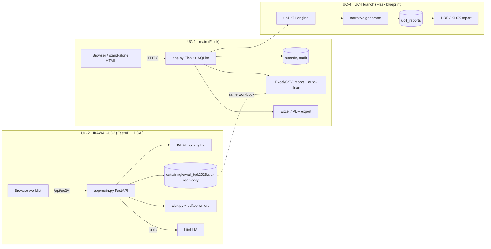
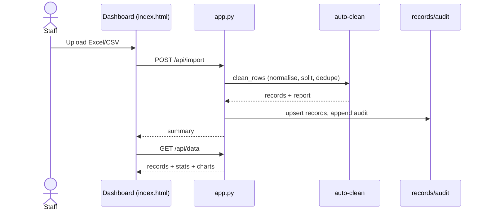
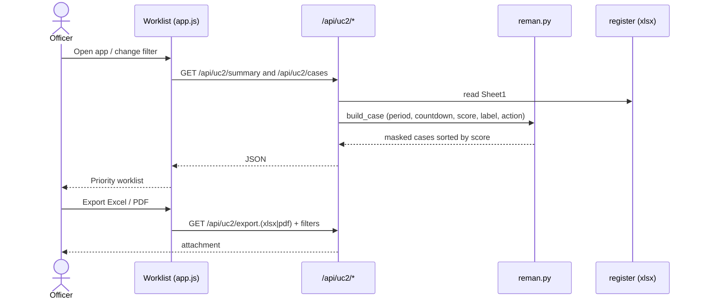
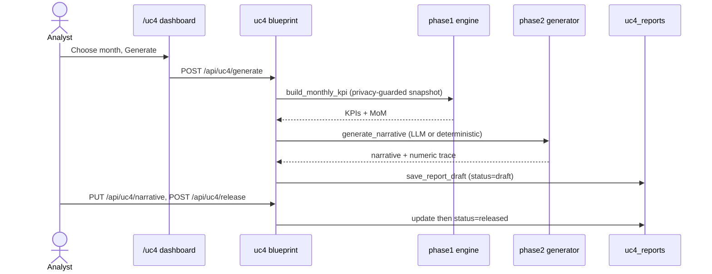
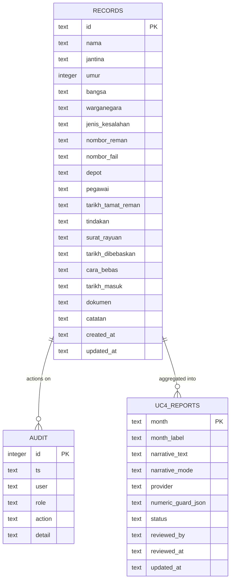

# Technical Design Document (TDD): IKAWAL / SmartDepot — Banduan Dagang Monitoring and Decision Support

| Field | Details |
| :--- | :--- |
| **Document ID** | `TDD-IKAWAL-001` |
| **Status** | Draft for review |
| **Document type** | Technical Design Document — this TDD describes **how** the system is built; it is **not** Test-Driven Development. |
| **Linked PRD** | `PRD-IKAWAL-001` — *Pengurusan Data Tahanan & Reman BPK 2026* (implied by `Ikawal_usecase_pipeline_v3.html`) |
| **Tutorial reference** | `Spec-Driven Development for Immigration Systems.pdf` / `.pptx` and `tdd_imm_001_digital_arrival_border_clearance.md` |
| **Owners** | Systems Engineering; BPK Immigration Operations |
| **Reviewers** | Policy Lead, Security, Data Owner (BPK), Airport/Depot Operations, Records Management |
| **Scope** | Whole programme: `main` plus every use-case branch (`IKAWAL-UC2`, `UC4`). `UC-1`, `UC-3` status recorded. |
| **Last updated** | 2026-11-27 |

## 1. Purpose and design principles

This document is the implementation contract for the IKAWAL programme. It describes the current
bridge between the approved use-case design (`Ikawal_usecase_pipeline_v3.html`) and the code that
exists on each branch: the Flask dashboard on `main`, the UC-2 decision-support service on
`IKAWAL-UC2`, and the UC-4 monthly report generator on `UC4`.

It follows the tutorial's spec-driven sequence:

1. **Define** the policy and measurable outcome in the PRD.
2. **Design** architecture, sequence, data model, and API contract here.
3. **Agree** edge cases, security controls, and fallback behaviour with officers and reviewers.
4. **Build** only against the reviewed and versioned contract.

Design principles:

- **One record, one truth:** the reman register (`records`) is the single source; dashboards,
  decision support, reports and exports all read from it.
- **Minimise exposure:** only the fields an officer needs are shown or returned; detainee names are
  masked and `catatan` never leaves the server for model or export paths.
- **Make decisions traceable:** every write and every generated report is recorded in the `audit`
  trail; UC-4 separates `draft` from `released`.
- **Keep policy separate from transport:** outcomes are explicit `status` / reason codes, not inferred
  from HTTP status alone.
- **Prefer deterministic, reviewable behaviour:** UC-2 scoring is rules, not a model; UC-4 narratives
  fall back to a deterministic template and every number is traced back to the KPI snapshot.
- **Minimal runtime surface per branch:** the UC-2 service adds **no** runtime dependency beyond the
  PCAI starter (standard-library `.xlsx`/PDF writers).

## 2. Scope and requirements

### 2.1 Programme objective

Give BPK officers and supervisors one dependable view of foreign detainees under remand (*banduan
dagang*), automatically flag which cases need action, forecast depot pressure, and produce the monthly
report — while keeping personal data masked and every action auditable.

### 2.2 Use cases, branch and implementation status

| Use case | Design reference | Branch | Stack | Status |
| :--- | :--- | :--- | :--- | :--- |
| **UC-1** Interactive Monitoring Dashboard (+ data entry) | `Ikawal_usecase_pipeline_v3.html` §5 UC-1 | `main` | Flask + SQLite + template UI + standalone HTML apps | Implemented (no automated tests) |
| **UC-2** Case Decision Support (reman countdown + risk scoring + recommended action) | §5 UC-2, §6 pipeline | `IKAWAL-UC2` | FastAPI (PCAI starter) + standard-library xlsx/pdf | Implemented + tested |
| **UC-3** AI Depot Population Forecasting | §5 UC-3 | *(none)* | — | **Not implemented.** Only a UC-2/UC-3 adapter stub exists in UC-4 |
| **UC-4** AI Insight & Automated Report Generator | §5 UC-4 | `UC4` | Flask blueprint + SQLite + LLM (optional) | Implemented + tested |

### 2.3 Product requirements → design response

| Requirement (PRD) | Design response | Acceptance measure |
| :--- | :--- | :--- |
| Replace the hand-kept Excel register | `records` table seeded from `data/iringkawal_bpk2026.xlsx` with auto-clean | First run imports the bundled workbook and reports the row count |
| See the picture without manual counting | Server dashboard (`templates/index.html`) + `/api/data` aggregates | KPI cards and charts match the dataset |
| Identify cases needing action first | UC-2 countdown + risk score + recommended action | Priority worklist sorted by score; every ranked case has reasons |
| Keep personal data out of the way | Masking, `catatan` excluded from model/export; PII guard in UC-4 | Exports and LLM prompts contain no raw name/`catatan` (verified by tests) |
| Produce the monthly report reliably | UC-4 KPI snapshot → narrative → PDF/XLSX, `draft` then `released` | Numbers trace to the snapshot; analyst release required |
| Work offline / in-cluster | UC-2 runs on the PCAI starter; standalone HTML apps work with no server | `app.html`, `sistem_tahanan.html`, `reman35_contoh.html` open directly |

### 2.4 In scope

- UC-1 dashboard, records CRUD, Excel/CSV import with auto-clean, Excel/PDF export, audit log, roles.
- Standalone offline HTML dashboards built from `src/` templates.
- UC-2 read-only decision support over the register, plus Excel/PDF/CSV export of the worklist.
- UC-4 monthly KPI snapshot, LLM/fallback narrative, draft/release workflow, PDF/XLSX export.

### 2.5 Out of scope

- UC-3 forecasting (no branch); biometrics; e-Gate integration; visa processing.
- Authentication federation with a central IdP for `main` (local password roles only); UC-2 relies on
  the PCAI oauth2-proxy pattern (not exercised locally).
- Live cluster deployment for any branch (artifacts exist for UC-2 only).

## 3. Actors, assumptions, and terminology

### 3.1 Actors

| Actor | Responsibility |
| :--- | :--- |
| Staff Iringkawal (`staff`) | Upload/import, add, edit, delete records, export, run UC-2 read, generate UC-4. |
| Penyelia (`penyelia`) | Edit and export; view UC-2 and UC-4; no delete/upload. |
| Boss (`boss`) | View and export only. |
| BPK Data Owner | Confirms new fields, code lists, retention. |
| Investigating officer (`pegawai`) | Named owner of a case; receives the UC-2 worklist item. |
| LLM (LiteLLM) | Optional UC-2 chat replies and UC-4 narrative; never authoritative. |

### 3.2 Assumptions requiring confirmation

- Data is **dummy/derived** for the workshop; real personal data handling and retention need sign-off.
- The canonical register is `data/iringkawal_bpk2026.xlsx` (2,199 rows × 15 columns). UC-2 also
  accepts the 14-column `start–end` shape.
- UC-4's LLM endpoint is optional; determinism is required when unavailable.
- `main` runs on `127.0.0.1:5000`; UC-2 on `127.0.0.1:8000`.

### 3.3 Terminology

- **Reman** — remand period. **Banduan dagang** — foreign detainee. **Depot** — DIKK / DIP.
- **TDD** in this document = Technical Design Document.

## 4. High-level architecture

Three independently runnable deliverables share one dataset and one audit store (where a database
exists).



| Component | Responsibility | Trust boundary |
| :--- | :--- | :--- |
| `app.py` (Flask, `main` / `UC4`) | Session auth, records CRUD, import/clean, export, audit; hosts UC-4 blueprint | Core application; trusts session cookie. |
| `templates/index.html` | Server-rendered dashboard consuming the JSON API | Controlled browser client. |
| `app.html` / `sistem_tahanan.html` / `reman35_contoh.html` | Stand-alone dashboards (SheetJS, `localStorage` fallback) | Untrusted static client; no server session. |
| `smartdepot/app/main.py` (FastAPI, `IKAWAL-UC2`) | UC-2 HTTP boundary, settings, size limits, identity | Core application; trusts proxy identity header in `proxy` mode. |
| `smartdepot/app/reman.py` | Pure rule engine (countdown, score, label, action, masking) | Deterministic, no I/O. |
| `smartdepot/app/{xlsx,pdf}.py` | Standard-library spreadsheet/PDF writers and reader | Pure functions. |
| `uc4/` package | KPI snapshot, narrative, report store and export | Reads `records`, writes `uc4_reports` + `audit`. |
| SQLite `ikawal.db` | `records`, `audit`, `uc4_reports` | Restricted data zone. |
| LiteLLM gateway | Optional narrative/chat | External model boundary; never authoritative. |

### 4.1 Request lifecycle (example: UC-2 worklist)

1. Browser requests `GET /api/uc2/cases`.
2. `app/main.py` resolves the register (`APP_REMAN_FILE` → `data/` → `app/data/` → `.local/` → repo `data/`).
3. `store.load_cases` reads Sheet1 with the standard-library reader, maps headers, scores each row.
4. Filters are applied, results sorted by score, then masked `to_public()` rows are returned.
5. `app.js` renders the table with `textContent` only; exports reuse the same filter helper.

## 5. Primary and alternate interaction flows

### 5.1 UC-1 — import and dashboard refresh



### 5.2 UC-2 — decision support



### 5.3 UC-4 — monthly report



### 5.4 Alternate and failure flows

- **UC-2 register missing:** `/api/uc2/*` returns `503` with a Malay hint; the UI shows it and does not
  crash. Invalid dates score `0` / label `tidak sah` and are listed under data-quality issues.
- **UC-2 model unavailable:** chat returns a translated gateway error; the worklist and exports still
  work (they never call the model).
- **UC-1 no dataset:** the app seeds 12 sample records and logs a `Seed` audit event.
- **UC-4 LLM unavailable:** `generate_narrative` falls back to the deterministic narrative.

## 6. Data model and database design



### 6.1 Data rules and constraints

- `records.id` is a random `r` + 10 hex chars (no sequential guessing).
- `nombor_reman` is the business key for duplicate detection (`dup_key`); batches group by `nombor_fail`.
- Derived, not stored: `days_left`, `status_semasa`, `is_urgent`, `is_bebas`, `has_rayuan`.
- `audit` is append-only from the application's perspective; `action` values include `Seed`, CRUD and
  UC-4 `generate`/`release`.
- `uc4_reports.status` is `draft` by default and set to `released` by the application (not a DB
  constraint); editing the narrative resets it to `draft`. `month` is `YYYY-MM`.
- UC-2 holds **no** database: the register workbook is read-only and cached by file mtime.
- Personal data: `nama` is masked in UC-2/UC-4 outputs; `catatan` is excluded everywhere except the
  officer-only UC-1 record view.

### 6.2 Recommended indexes (SQLite)

| Table | Index | Purpose |
| :--- | :--- | :--- |
| `records` | `nombor_reman` | Duplicate detection and lookups. |
| `records` | `(depot, tarikh_tamat_reman)` | Dashboard and worklist filtering. |
| `audit` | `(ts DESC)` | Audit review. |
| `uc4_reports` | `month` (PK) | One report per month. |

## 7. API contract

### 7.1 UC-1 / UC-4 — Flask (`main`, `UC4`)

**Auth:** session cookie (`staff` / `penyelia` / `boss`). Server-rendered pages: `/`, `/login`, `/logout`,
`/app`, `/app.html`.

| Method | Path | Purpose | Min role |
| :--- | :--- | :--- | :--- |
| `GET` | `/api/me` | Session and role | any |
| `GET` | `/api/data` | Records + stats + charts (`filter,q,officer,sort`) | any |
| `POST` | `/api/records` | Create | staff |
| `PUT/PATCH` | `/api/records/<id>` | Update | staff/penyelia |
| `DELETE` | `/api/records/<id>` | Delete | staff |
| `DELETE` | `/api/records` | Clear all | staff |
| `POST` | `/api/sample` | Load 12 demo records | staff |
| `POST` | `/api/import` | Upload Excel/CSV (`file`) | staff |
| `GET` | `/api/export/xlsx` | Clean Excel download | any |
| `GET` | `/api/export/pdf?period=` | Period PDF report | any |
| `GET/POST/DELETE` | `/api/audit` | Audit log | staff |

**UC-4 blueprint** (`uc4/phase3_reports/blueprint.py`), same session auth:

| Method | Path | Purpose |
| :--- | :--- | :--- |
| `GET` | `/uc4` | Monthly report dashboard (HTML) |
| `GET` | `/api/uc4/months` | Months available |
| `GET` | `/api/uc4/report` | Saved or built report for a month |
| `POST` | `/api/uc4/generate` | Build KPI + narrative, save draft |
| `PUT` | `/api/uc4/narrative` | Edit narrative (resets to draft) |
| `POST` | `/api/uc4/release` | Release the report |
| `GET` | `/api/uc4/export/pdf`, `/api/uc4/export/xlsx` | Downloads |

### 7.2 UC-2 — FastAPI (`IKAWAL-UC2`)

**Auth:** `local` (workshop) or `proxy` (PCAI oauth2-proxy, `x-forwarded-user`). Read-only; no writes.

| Method | Path | Purpose |
| :--- | :--- | :--- |
| `GET` | `/api/info` | Model, tool availability, identity |
| `GET` | `/api/uc2/summary` | Counts by label/depot, overdue/due-today/invalid |
| `GET` | `/api/uc2/cases` | Filtered worklist (`label,depot,officer,status,q,open,limit`) |
| `GET` | `/api/uc2/case/{NO.REMAN}` | One masked case (+ duplicate count) |
| `GET` | `/api/uc2/export.xlsx` / `.csv` / `.pdf` | Export the current filtered view |
| `POST` | `/api/chat` | Bounded model loop with `reman_summary`, `list_priority_cases`, `get_case` |

Example — worklist case (masked; `catatan` absent):

```json
{
  "no_reman": "26(703)BD", "nama": "M******* R**** B** A* B******", "depot": "DIKK",
  "tindakan": "BELUM_MUKTAMAD", "hari_berbaki": -208, "status_reman": "tertunggak",
  "score": 55, "label": "Tinggi",
  "action": "Dalam 48 jam: siapkan draf lanjutan reman atau selesaikan langkah ujian DNA / rayuan.",
  "reasons": ["Reman tamat/tertunggak dan TINDAKAN belum muktamad (+40)",
              "TINDAKAN belum muktamad / tidak jelas (+15)"],
  "issues": []
}
```

### 7.3 OpenAPI / Swagger requirement

The tutorial requires a published OpenAPI 3.0 contract and Swagger UI before implementation. **Current
gap:** neither `main` nor `UC-2` publishes OpenAPI; UC-2 has JSON endpoints without a schema document.
Adding a versioned OpenAPI contract for `/api/uc2/*` is a required action (see §14).

## 8. Decision and failure matrix

| Condition | Use case | Persisted effect | API result | Officer action |
| :--- | :--- | :--- | :--- | :--- |
| Reman overdue/ends today, `tindakan` not final | UC-2 | none (read-only) | `200`, label ≥ Tinggi | Act today per recommended action |
| Reman ends in 1–3 days, not final | UC-2 | none | `200`, +25 | Prepare within 48 h |
| Invalid/blank reman end date | UC-2 | excluded from scoring | `200`, label `tidak sah` | Fix the record in UC-1 |
| Register workbook absent | UC-2 | none | `503` (Malay hint) | Set `APP_REMAN_FILE` / place the file |
| Unknown `NO.REMAN` | UC-2 | none | `404` | Check the reference |
| LLM inaccessible (UC-2 chat / UC-4 narrative) | UC-2 / UC-4 | UC-4 saves draft | `502` / deterministic narrative | Retry or use the template |
| Dataset absent on first run (UC-1) | UC-1 | 12 sample records + `Seed` audit | `200` | Upload the real register |
| Import with duplicates | UC-1 | duplicates flagged, not silently merged | summary/report | Review flagged rows |
| Narrative has a number not in the snapshot | UC-4 | draft blocked by numeric guard | validation error | Correct or regenerate |

## 9. Security, privacy, and audit

### 9.1 Access control

- `main`/`UC4`: role-based capability map (`upload/add/edit/del/export`); server-side session; passwords
  are Werkzeug hashes seeded from `IKAWAL_PW_*` env vars.
- `UC-2`: in `proxy` mode requires `x-forwarded-user`; POSTs are origin-checked against the public URL;
  the app service must stay private behind NetworkPolicy; the browser never receives the LiteLLM key.

### 9.2 Data protection

- Masking: UC-2 masks `nama` (`M******* R**** …`); `catatan` is never returned or exported.
- UC-4 `FORBIDDEN_PII_KEYS` guard (`nama, catatan, nombor_reman, nombor_fail, ic, passport`) blocks PII
  from KPI snapshots and LLM prompts; `contains_forbidden_keys` raises before narrative generation.
- Auditing: every write and every UC-4 generate/release appends to `audit`.
- Secrets live in `.local/` (UC-2) and env vars (Flask); none are committed.

### 9.3 Audit events

| Event | Source | Required fields |
| :--- | :--- | :--- |
| `Seed` | UC-1 init | ts, user=system, action, detail |
| add/edit/delete/import/export | UC-1 | ts, user, role, action, detail |
| `UC-4 Jana Laporan` / `UC-4 Sunting Naratif` / `UC-4 Sahkan Laporan` / `UC-4 Eksport PDF` / `UC-4 Eksport XLSX` | UC-4 | ts, user, role, action, detail |
| UC-2 tool use | UC-2 | recorded in the chat trace (`tools`) returned to the browser |

Corrections are new events; existing audit rows are not overwritten.

## 10. Non-functional requirements and observability

| Area | Requirement | Verification |
| :--- | :--- | :--- |
| UC-2 correctness | Score/label/action follow the design weights and cut-offs | `tests/test_reman.py` (34 passing) |
| UC-2 privacy | No raw name or `catatan` in JSON/exports | Tests assert masking and absence |
| UC-2 portability | No runtime dependency beyond the PCAI starter | Standard-library xlsx/pdf writers; hash-locked image unchanged |
| UC-1 integrity | Duplicate `nombor_reman` and blank dates flagged, not merged | `dup_set` / import report |
| UC-4 determinism | Narrative numbers trace to the KPI snapshot | `trace_narrative_numbers`; `test_uc4_all_phases.py` |
| UC-4 privacy | KPI snapshot is PII-free | `assert_kpi_payload_safe`; `test_uc4_phase1.py` |
| Operability | UC-2 exposes `/health/live` and `/health/ready` | Starter endpoints unchanged |

Required metrics (not yet wired): `uc2_requests_total{outcome}`, `uc2_export_total{format}`,
`uc4_reports_total{status}`, `import_rows_total{result}`, `db_errors_total`.

## 11. Architectural trade-offs

| Decision | Chosen approach | Alternative | Rationale |
| :--- | :--- | :--- | :--- |
| UC-1 storage | SQLite | PostgreSQL | Zero-setup for the workshop; SQLite is enough for one depot team. |
| UC-1 UI | Server template + single-file HTML | SPA framework | Works offline and inside VS Code with no build step. |
| UC-2 runtime | FastAPI on the PCAI starter | Extend the Flask app | Deployable to PCAI with oauth2-proxy and no new dependencies. |
| UC-2 scoring | Deterministic rules | ML model | Explainable, reviewable, works on day-one data; ML deferred to v2. |
| UC-2 xlsx/pdf | Standard library | pandas/openpyxl/reportlab | Keeps the hash-locked image valid; no supply-chain growth. |
| UC-4 narrative | LLM with deterministic fallback + numeric trace | LLM only | Reports must be reproducible and every number sourced. |
| Separate services | One deliverable per branch | Single monolith | Each use case ships and is reviewed independently. |

## 12. Implementation and verification plan

Implementation proceeds in verifiable slices per branch:

1. **UC-1 (`main`):** approve field list and roles → import/clean → dashboard → exports → audit.
2. **UC-2 (`IKAWAL-UC2`):** approve weights/labels/actions → engine → store → endpoints → UI → exports.
3. **UC-4 (`UC4`):** approve KPI set → snapshot + privacy guard → narrative → draft/release → exports.
4. **UC-3 (not started):** approve intake/headcount model and exit-date capture before any build.

Minimum verification cases:

- UC-1: import the bundled workbook; duplicates and blank dates are flagged; exports match the screen.
- UC-2: overdue + non-final ⇒ `+40`; ≤3 days ⇒ `+25`; pending ⇒ `+15`; score caps at 100; label
  thresholds 60/35/15; exports contain masked names and no `catatan`; missing register ⇒ `503`.
- UC-4: KPI snapshot is PII-free; narrative numbers trace to the snapshot; edit resets to draft;
  release sets `released`; PDF/XLSX download works.
- Cross-cutting: no secret in the repo; UC-2 image builds with the unchanged lock file.

**Current test coverage:** UC-2 = 34 tests; UC-4 = 2 test files; UC-1 = **none** (gap → §14).

## 13. Pre-implementation sign-off checklist

- [ ] **PRD approved:** objective, user stories, acceptance criteria, out-of-scope signed off.
- [ ] **System mapped:** architecture and sequence diagrams reviewed by engineering and operations.
- [ ] **Data and APIs set:** ERD, constraints, and an OpenAPI contract published (UC-1 and UC-2).
- [ ] **TDD signed off:** UC-2 weights/labels/actions, masking rules, UC-4 privacy guard, retention.
- [ ] Terminology and language agreed (Bahasa Melayu for officer-facing UI).
- [ ] Automated tests for UC-1 (import, CRUD, export) added.
- [ ] Retention/archival and key management approved by Security / Records Management.
- [ ] Non-production data and environment available for each branch.

## 14. Open decisions and change control

| Decision | Owner | Due before |
| :--- | :--- | :--- |
| Publish OpenAPI 3.0 + Swagger UI for UC-1 and UC-2 endpoints | Systems Engineering | First external integration |
| UC-2 risk weights, label cut-offs and action list sign-off | Depot Head / Legal | UC-2 go-live |
| Retention/archival for personal data and audit events | Records Management + Security | Production acceptance |
| Canonical register location and deployment data path (`APP_REMAN_FILE` / mounted `data/`) | Operations / ICT | UC-2 deployment |
| UC-3 intake/headcount model and exit-date capture | Operations / Data Owner | UC-3 kick-off |
| Automated test suite for the `main` Flask app | Systems Engineering | Next release |
| Single sourced narrative provider for UC-4 (on-prem LLM vs Bedrock) | Integration Owner | UC-4 pilot |

Any change to an endpoint, status/label code, scoring weight, or audit field requires an updated TDD
version, review of affected diagrams/tests, and explicit sign-off before implementation proceeds.

## Appendix A — Branch map

| Branch | Local | Remote | Contains |
| :--- | :--- | :--- | :--- |
| `main` | yes | `origin/main` | Flask app, `templates/`, standalone HTML apps, `src/`, dataset, design HTML |
| `IKAWAL-UC2` | yes | `origin/IKAWAL-UC2` | `main` + `bd94837`, `1441f60`, `ced4019`, merge `4f9f7ec` (`smartdepot/`) |
| `UC4` | no | `origin/UC4` | `main@649ccef` + `91455c8` (`uc4/`, tests, blueprint hook) |
| `UC2` | yes | — | reset to `main` (retired) |

## Appendix B — Use case → code map

| Use case | Entry | Core code | Tests |
| :--- | :--- | :--- | :--- |
| UC-1 | `app.py` (:5000), `app.html` | `app.py` (clean/CRUD/export), `templates/index.html`, `src/build_*.py` | none |
| UC-2 | `smartdepot/app/main.py` (:8000) | `reman.py`, `store.py`, `xlsx.py`, `pdf.py`, `agent.py`, `static/` | `smartdepot/tests/test_reman.py` |
| UC-4 | `/uc4` on Flask | `uc4/phase1_kpi`, `phase2_narrative`, `phase3_reports`, `phase4_ui` | `tests/test_uc4_phase1.py`, `tests/test_uc4_all_phases.py` |
| UC-3 | — | adapter stub in `uc4/phase1_kpi/engine.py` only | none |
